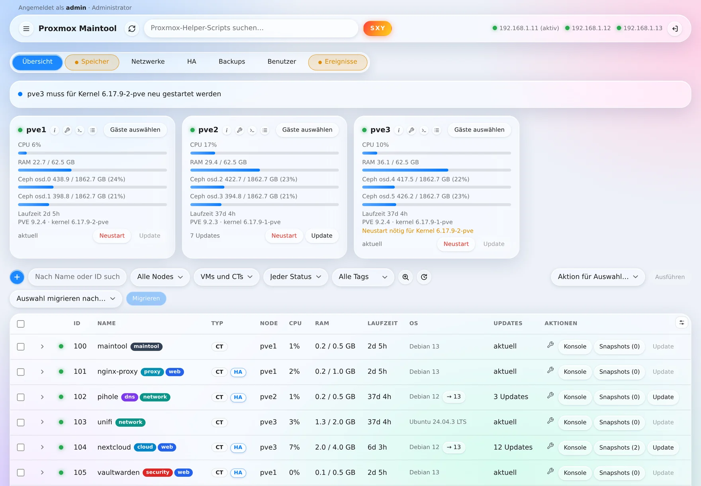
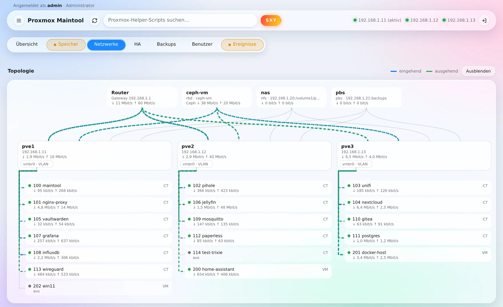
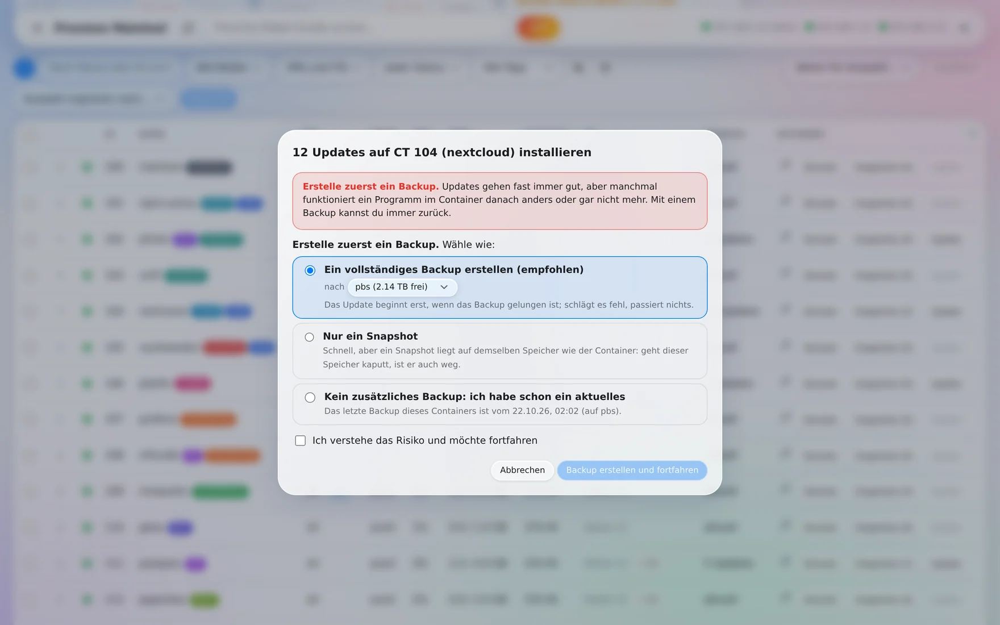
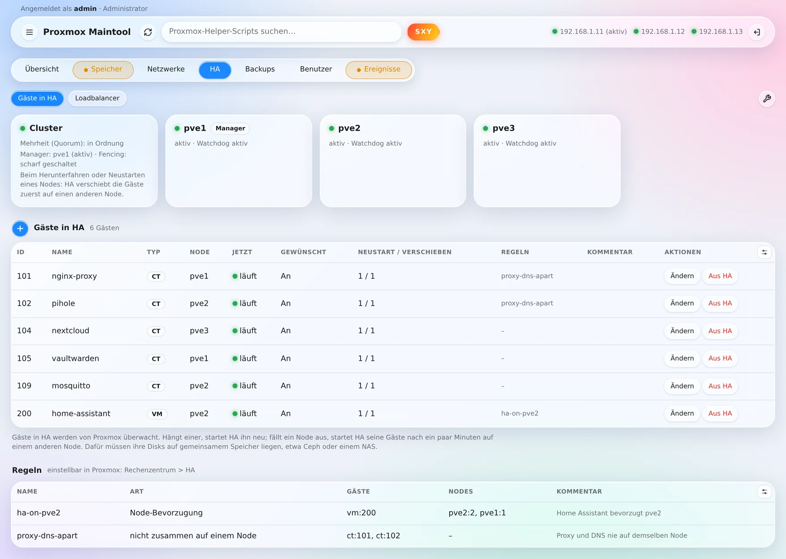
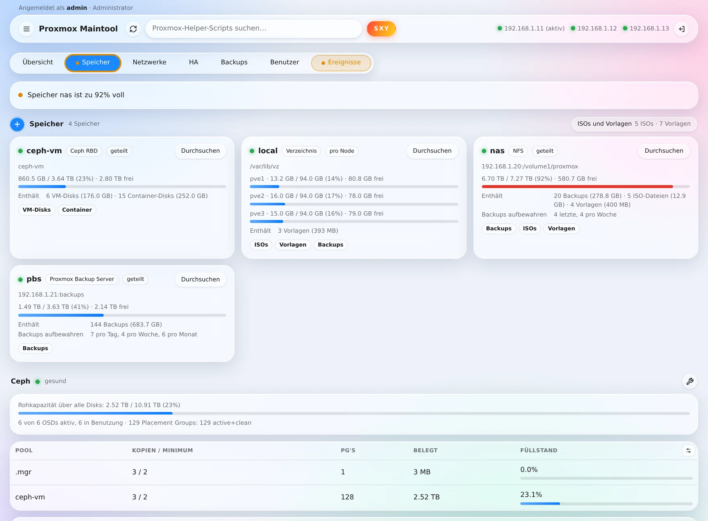
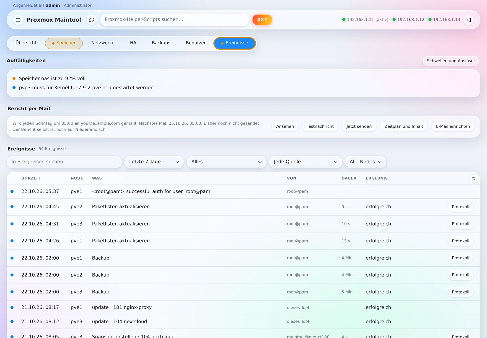
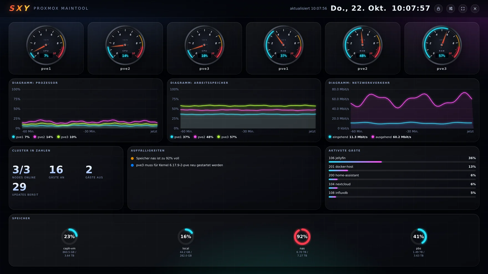

# Proxmox Maintool

Eine Webseite für die tägliche Wartung einer Proxmox-VE-Umgebung, auf Niederländisch, Englisch oder Deutsch.
Erstellt von Eduard Wichers.

Diese Anleitung gibt es auch auf Niederländisch ([LEESMIJ.md](LEESMIJ.md)) und Englisch ([README.md](README.md)). Alle drei liegen der Setup-Datei bei.

**[Version 1.5.3 als ZIP herunterladen](../../archive/refs/tags/v1.5.3.zip)**: Der Dateiname enthält die Versionsnummer (die grüne Schaltfläche Code liefert immer …-main.zip). Diese ZIP kannst du in einem Schritt bei **Tool aktualisieren** übergeben. Entpackt liegt oben die Setup-Datei `maintool-setup.sh`, um das Tool auf einem Node zu installieren; der Rest ist der Quellcode. <!-- github -->

 <!-- github -->

## Zuerst lesen

- **Das Tool erhält Administratorrechte für deinen ganzen Cluster.** Es verwendet einen Zugriffsschlüssel
  (API-Token) mit der Rolle Administrator und darf auf jedem Node als root ein festes Hilfsskript starten (Updates
  installieren, Node neu starten). Wer sich als Administrator im Tool anmelden kann, kann also Container und VMs
  stoppen, migrieren, aus einem Backup wiederherstellen und Nodes neu starten. Wer die Rolle eines Reiters hat, kann
  das für diesen Teil. Wer nur lesen darf, kann nichts ändern, sieht aber alles.
- **Nur in einer Umgebung getestet:** Proxmox VE 9, ein Cluster aus drei Nodes mit Ceph und nur Containern. Ein
  einzelner Node, ein Cluster ohne Ceph, VMs und Proxmox VE 8 sind nicht getestet.
- **Benutzung auf eigene Gefahr.** Es gibt keine Garantie, und der Autor haftet nicht für Schäden, Datenverlust oder
  Ausfälle (MIT-Lizenz, siehe `LICENSE`). Sorge für gute Backups.
- **Stelle das Tool nicht einfach ins Internet.** Benutze es zu Hause in deinem eigenen Netzwerk, oder setze ein VPN
  oder eine zusätzliche Zugangsschicht davor.

## Was das Tool kann

- Eine Übersicht über Nodes, Container und VMs, mit CPU, Arbeitsspeicher und Plattenbelegung live (Ceph oder lokale
  Platten).
- Einen Reiter Speicher: jeder Speicher mit Füllstand und Inhalt (mit der Schaltfläche Durchsuchen siehst du, was
  darauf liegt), der Zustand und die Pools von Ceph, und die Platten in den Nodes mit ihrem Zustand und Verschleiß.
  Mit dem Schraubenschlüssel bei Ceph verwaltest du Monitore, Manager, OSDs, Pools und Flags und baust Ceph auf, wo
  es noch nicht läuft.
- Eine Bibliothek mit ISOs und Container-Vorlagen (Reiter Speicher, Schaltfläche ISOs und Vorlagen): Das Tool sucht sie selbst auf jedem Speicher und
  zeigt, auf welchen Nodes sie nutzbar sind. Eine ISO lässt du über eine Webadresse herunterladen (Proxmox holt sie
  selbst; von einer Adresse im eigenen Netzwerk darf das nur ein Administrator), eine Vorlage holst du aus der Liste von Proxmox, und was du nicht mehr brauchst, löschst du (eine ISO nur,
  wenn keine VM sie im CD-Laufwerk hat). Bei einer neuen VM oder einem neuen Container wählst du daraus.
- Pro Node eine Sprechblase mit kurzen Informationen (das kleine i neben dem Namen) und ein Schraubenschlüssel für
  die Einstellungen dieses Nodes: Notiz, Zeitzone, DNS, Wake-on-LAN, die Wartezeit vor dem Start der Gäste und die
  Paketquellen (an- oder ausschalten oder eine Standardquelle von Proxmox hinzufügen).
- Pro Node ein Protokoll (die Schaltfläche neben der Konsole): sein Systemprotokoll mit einem Filter nach Zeitraum,
  Quelle, Text und Problemen (auch als Datei zu speichern), seine Aufgaben mit dem Log jeder Aufgabe, der Zustand
  seiner Dienste, was der Cluster über ihn meldet und was das Tool auf ihm getan hat.
- Einen Reiter Netzwerke: die Schnittstellen jedes Nodes, VLANs, die Netzwerkkarten und Adressen aller Gäste (mit
  einer Warnung bei einer doppelten Adresse) und das Netzwerk des Clusters selbst. Mit der Plus-Schaltfläche bereitest
  du ein VLAN vor: für Container und VMs auf allen Nodes zugleich oder als zusätzlichen Anschluss für einen Node. Für
  jede Netzwerkkarte eines Gastes wählst du in den Spalten Netzwerk und VLAN ein anderes Netzwerk oder ein angelegtes
  VLAN.
- Auf dem Reiter Netzwerke eine Topologie: der Router, der gemeinsame Speicher, die Nodes mit ihren Bridges und die Gäste daran, mit
  bewegten Strömen, die zeigen, wie viel Verkehr gerade über jede Verbindung geht.
- Einen Reiter Ereignisse: was gerade Aufmerksamkeit braucht (Node weg, Ceph, voller Speicher, HA, Platten) und was
  passiert ist: die Aufgaben jedes Nodes, Meldungen des Clusters und was über das Tool getan wurde, mit Filtern (auch
  für einen eigenen Zeitraum von Datum bis Datum) und dem Protokoll jeder Aufgabe.
- Auffälligkeiten pro Reiter: Die Schaltfläche eines Reiters wird orange bei einer Warnung und rot bei einem Fehler in
  diesem Teil; ohne Farbe ist alles in Ordnung. Ereignisse zählt alles zusammen. Mit Schwellen und Auslöser (Reiter
  Ereignisse) legst du selbst fest, was eine Warnung oder ein Fehler ist, ab welchem Prozentsatz, oder ob eine Meldung
  ganz aus ist.
- Pro Gast ein Schraubenschlüssel zum Bearbeiten: Name, Kerne, Arbeitsspeicher, Swap, Start mit dem Node, Schutz und
  Notiz, die Tags, die IP-Adressen und DNS seiner Netzwerkkarten, und seine Platten vergrößern.
- Tags von Containern und VMs, in den Farben von Proxmox: neben dem Namen, mit dem Schraubenschlüssel zu bearbeiten,
  und ein Klick auf einen Tag (oder die Liste Alle Tags) zeigt nur die Gäste mit diesem Tag.
- Die Schaltfläche SXY: ein bildschirmfüllendes Dashboard für die Wand, mit Drehzahlmessern, Grafiken der letzten
  Stunde, Auffälligkeiten, den am stärksten belasteten Gästen, dem Speicher, einer Uhr und nach Wahl VMs und CTs mit
  eigenen Anzeigen. Jede Anzeige und Kachel ist ein Widget, das du verschieben und vergrößern oder verkleinern kannst;
  du wählst selbst, was angezeigt wird und wie oft es aktualisiert wird.
- Starten, Herunterfahren, Neustarten und erzwungenes Stoppen mehrerer Gäste zugleich; Migrieren auf einen anderen
  Node. Mit Gäste auswählen bei einem Node hakst du auf einmal alles an, was dort läuft; ein zweiter Klick (Auswahl
  aufheben) hakt es wieder ab.
- Pro Gast eine aufklappbare Zeile mit mehr Informationen: IP-Adresse, Netzwerk, Platten, Arbeitsspeicher, HA und das
  letzte Backup.
- Gäste endgültig löschen (nur wenn sie aus sind, nach dem Abtippen ihrer IDs).
- Mit der Plus-Schaltfläche einen Container oder eine VM erstellen (mit den nächsten freien IDs und einer ISO oder
  Vorlage aus der Bibliothek), eine NFS- oder SMB-Freigabe als Speicher einbinden oder einen Backup-Zeitplan anlegen.
- Snapshots erstellen, wiederherstellen und löschen.
- Updates auf den Nodes und in Containern mit Debian oder Ubuntu suchen und installieren, vorher mit einer deutlichen
  Warnung und der Wahl eines Backups (vollständig, nur ein Snapshot oder ein schon vorhandenes aktuelles); einen Node
  sicher neu starten.
- Automatische Updates nach einem oder mehreren Zeitplänen: pro Zeitplan die gewählten Container und auf Wunsch die
  Nodes, ein eigener Zeitpunkt und ein Snapshot oder Backup vorab.
- Einen Container auf die nächste Debian-Version bringen, mit einem vollständigen Backup nach Wahl und immer einem
  Snapshot vorab.
- Über Cloudflare Zero Trust eine Warnung und die Wahl, das Tool nur anzusehen.
- Einen Reiter Backups: Zeitpläne verwalten, sofort ein Backup erstellen und wiederherstellen. Es sind gewöhnliche
  Proxmox-Backups, die du auch ohne dieses Tool wiederherstellen kannst. Unter Protokoll stehen pro Zeitplan der
  letzte Lauf und sein Ergebnis, und jeder Backup-Lauf mit den Gästen, dem Speicher, der Dauer, was schiefging und dem
  Protokoll.
- Einen Reiter HA: wie es um High Availability pro Node steht, welche Gäste HA überwacht, und Gäste in HA aufnehmen,
  ihre HA-Einstellungen ändern oder sie wieder herausnehmen, auch für mehrere Gäste zugleich. Unter Loadbalancer
  verteilt Proxmox die HA-Gäste automatisch auf die Nodes, auf Wunsch mit Containern nur nachts. Mit dem
  Schraubenschlüssel siehst du, ob der Cluster bereit für HA ist, verwaltest die HA-Regeln, wählst, was HA beim
  Herunterfahren eines Nodes tut, und schaltest HA für Wartung vorübergehend aus.
- Einen Reiter Benutzer (nur für Administratoren): die Benutzer und Gruppen von Proxmox selbst anlegen, bearbeiten
  und löschen, Passwörter setzen und Rechte vergeben oder entziehen, und API-Tokens mit eigenen Rechten.
- Ein Terminal zu einem Container und für Administratoren eine Konsole (Shell) auf einem Node, direkt in der Seite.
- Tabellen nach deinem Geschmack: Spalten ein- und ausblenden (bei den Gästen auch zusätzliche Spalten wie Platte,
  Kerne und Labels) und eine Tabelle auf ihrem Reiter nach oben oder unten verschieben.
- Suchen im Katalog der Proxmox VE Helper-Scripts (community-scripts.org).
- Auf Wunsch ein Bericht per Mail: jeden Tag, jede Woche, alle zwei Wochen oder jeden Monat, mit den Teilen, die du
  wählst, und auf Wunsch nur, wenn etwas los ist. Die Mail richtest du in der Seite ein, für Gmail, Outlook,
  Microsoft 365, iCloud, Yahoo, Ziggo, KPN oder einen eigenen Mailserver, und du kannst eine Testmail senden.
- Eine eigene Hintergrundfarbe und die Sprache der Seite (Niederländisch, Englisch, Deutsch) über das Menü.
- Das Tool selbst aktualisieren: Es sieht selbst, wenn es eine neue Version auf GitHub gibt (die Menü-Schaltfläche wird
  orange), und holt sie mit einer Schaltfläche, oder du übergibst die Setup-Datei einer neueren Version oder die ZIP von
  GitHub selbst.
- Das Passwort des Tools über das Menü ändern.
- Anmelden mit einem Sicherheitsschlüssel (YubiKey oder Passkey): ohne Passwort oder als zusätzlicher Schritt nach dem
  Passwort.
- Weitere Benutzer, jeder mit eigenem Passwort: als Administrator, nur lesend oder mit der Rolle eines oder mehrerer
  Reiter (Menü, Benutzer). Dort legt der Administrator auch fest, wie lang ein Passwort mindestens sein muss.
- Anmelden mit SSO: OpenID Connect (Microsoft Entra ID/Azure, Google, Authentik, Keycloak und ähnliche), Cloudflare
  Access oder ein Proxmox-Konto. Pro Benutzer verknüpfst du sein Konto und legst fest, ob er sich daneben noch mit
  einem Passwort anmelden darf.

## Was du brauchst

- Proxmox VE 9 (Version 8 kann funktionieren, ist aber nicht getestet), auf gewöhnlicher PC-Hardware (amd64).
- Root-Zugriff auf die Shell eines Nodes.
- Eine freie, feste IP-Adresse in deinem Netzwerk für den Container.
- Internet für den Container während der Installation (Debian- und Python-Pakete), und danach, wenn das Tool neue
  Versionen auf GitHub sehen soll.
- Etwa 5 GB freien Speicher und 512 MB Arbeitsspeicher.

## Installieren

1. Lege `maintool-setup.sh` auf einen Node, zum Beispiel von deinem eigenen Computer aus:

       scp maintool-setup.sh root@ADRESSE-DEINES-NODES:/root/

   Hast du die ZIP von GitHub heruntergeladen, dann entpacke sie: Die Setup-Datei ist `maintool-setup.sh`, oben neben
   dieser Anleitung. Die anderen Dateien sind der Quellcode; wer will, erstellt daraus mit `bash build.sh` selbst eine
   Setup-Datei (`dist/maintool-setup.sh`). In ZIPs bis einschließlich Version 1.4 ist die fertige Setup-Datei noch nicht
   enthalten.

2. Öffne die Shell dieses Nodes (in der Weboberfläche von Proxmox: Node > Shell) und starte:

       bash /root/maintool-setup.sh

3. Wähle die Sprache (English, Nederlands oder Deutsch; Enter übernimmt den Vorschlag), lies die Warnung,
   beantworte die Fragen und bestätige die Zusammenfassung. Bis zu dieser Bestätigung ändert sich nichts.

Vor den Fragen prüft die Setup-Datei, ob jeder Node unter der Adresse erreichbar ist, unter der der Cluster ihn
kennt. Stimmt das nicht, meist wegen einer alten Adresse in `/etc/hosts` auf diesem Node nach dem Ändern seiner
Adresse, dann sagt sie, was du dagegen tust, und fragt, ob du trotzdem fortfahren willst. Sie funktioniert mit jeder
Spracheinstellung des Nodes (auch `en_US.UTF-8`).

Die Setup-Datei fragt der Reihe nach: die Sprache; `einverstanden` nach der Warnung; die ID und den Namen des neuen
Containers; den Speicher für seine Platte und für die Debian-Vorlage; das Netzwerk (Bridge); eine feste IP-Adresse
mit Netzgröße, zum Beispiel 192.168.1.50/24; den Router (Gateway); eine VLAN-Nummer (leer, wenn du keine VLANs
benutzt); sowie Benutzername und Passwort für das Tool (mindestens 8 Zeichen; was du tippst, bleibt unsichtbar).
Nach der Zusammenfassung tippst du `ja`, um es auszuführen; alles andere bricht ab.

Ein Wert in eckigen Klammern ist die Vorgabe: Enter übernimmt ihn. Bei einer Auswahl aus einer Liste tippst du die
Nummer vor der Option oder ihren Namen. Um die Sprachfrage zu überspringen, setze die Sprache nach vorn:
`bash maintool-setup.sh --lang de` (oder `nl`, `en`). `bash maintool-setup.sh --liesmich` zeigt diese Anleitung
(`--leesmij` auf Niederländisch, `--readme` auf Englisch).

Nach ein paar Minuten ist das Tool unter `https://DIE-GEWÄHLTE-ADRESSE:8443` bereit. Dein Browser warnt beim ersten
Mal vor dem Zertifikat, weil das Tool sein eigenes Zertifikat erstellt. Das ist normal.

Am Ende läuft ein Selbsttest, der meldet, was funktioniert und was nicht.

## Was die Setup-Datei anlegt

- Einen Container (Debian, 1 Kern, 512 MB, 4 GB) mit dem Tag `maintool`, in dem das Tool läuft.
- In Proxmox den Benutzer `maintool@pve` mit der Rolle Administrator und einen Zugriffsschlüssel `ct<ID>`, der nur im
  Container bekannt ist. Jede Installation erhält einen eigenen Schlüssel.
- Auf jedem Node das Hilfsskript `/usr/local/sbin/maintool-agent`.
- Eine Zeile in `/etc/pve/priv/authorized_keys`: Der SSH-Schlüssel des Containers darf nur dieses Hilfsskript starten,
  und nur von der Adresse des Containers aus. Von der Datei wird vorher eine Kopie in `/root` angelegt.
- Ein Protokoll der Installation in `/var/log/maintool-setup.log` (ohne Passwörter oder Schlüssel).
- Im Container: das Tool in `/opt/maintool`, im Besitz von root (der Dienst kann sein eigenes Programm nicht ändern),
  mit seinen Python-Paketen in einem eigenen Ordner: feste Versionen, jede mit ihrer Prüfsumme kontrolliert
  (`requirements.txt`). Der Dienst `maintool` läuft streng abgeschirmt: Die Installation probiert zuerst jede
  Abschirmung aus und schaltet nur ein, was der Container erlaubt (`/etc/systemd/system/maintool.service.d/hardening.conf`).

## Aktualisieren und entfernen

Ab Version 1.5 behält das Tool GitHub selbst im Auge: kurz nach dem Start und danach alle sechs Stunden fragt es
GitHub, welche Versionen es gibt (ein Tag wie v1.5). Gibt es eine neuere, wird die Menü-Schaltfläche orange, unter
**Tool aktualisieren** steht, welche Version verfügbar ist, und Administratoren bekommen ein Fenster mit **Jetzt
aktualisieren**, **Später** und **Nicht mehr erinnern**. Nicht mehr erinnern gilt für dich und für diese Version, auf
jedem Gerät; das Menü bleibt orange, bis das Tool aktualisiert ist. In **Tool aktualisieren** holt die Schaltfläche
unter Von GitHub diese Version und prüft sie genauso wie eine Datei, die du selbst übergibst; nach deinem Passwort wird
sie installiert. An GitHub geht nur diese Frage, nichts über deinen Cluster. Willst du das nicht, trage `UPDATE_REPO=`
(leer) in `/etc/maintool/maintool.env` ein und führe im Container `systemctl restart maintool` aus.

Du kannst auch selbst eine Datei übergeben: Öffne im Tool das Menü, wähle **Tool aktualisieren** und übergib dort die
Setup-Datei der neueren Version oder gleich die ZIP dieser Version von GitHub: Das Tool holt die Setup-Datei dann selbst heraus. Das geht ab
Version 1.4.1 (sowohl das laufende Tool als auch die ZIP); läuft noch eine ältere Version, entpacke die ZIP zuerst und
wähle `maintool-setup.sh`. Das Tool prüft die Datei, fragt nach deinem Passwort, bewahrt eine Kopie der alten Version auf und stellt sie
von selbst wieder her, wenn die neue nicht richtig startet. Das ersetzt nur das Tool selbst. Ändert eine neue Version
mehr (das Hilfsskript auf den Nodes, den Dienst, Python-Pakete), dann meldet die Seite das, und du benutzt die
Setup-Datei auf dem Node:

    bash maintool-setup.sh --update ID

Sie fragt nach der Sprache und dann, ob du fortfahren willst: `ja` eintippen (mit `--yes` am Ende fragt sie das nicht).
Danach läuft sie im Hintergrund weiter (als systemd-Dienst) und zeigt ihre Ausgabe, damit die Aktualisierung auch
fertig wird, wenn die Verbindung abbricht, zum Beispiel in einer Konsole im Tool selbst, die mit neu startet.

Beim Aktualisieren stellt die Setup-Datei die neue Version zuerst vollständig neben die alte (die Python-Pakete
auch) und wechselt und startet erst dann neu. Antwortet die neue Version nicht, kommt die alte von selbst zurück.

Ab Version 1.5.2 kann das Tool das selbst starten: **Tool aktualisieren** zeigt dann **Über Node X aktualisieren**,
für den Node, auf dem der Container des Tools liegt. Melde dich als root@pam an der Konsole dieses Nodes an (die
Schaltfläche öffnet dieses Fenster) und bestätige mit deinem Passwort des Tools. Das Tool tippt dann einen Befehl in
die Shell dieses Nodes: Es holt die Setup-Datei aus seinem eigenen Container (`pct pull`), prüft den Fingerabdruck und
startet `maintool-setup.sh --update ID --yes` im Hintergrund. Das Tool startet zwischendurch neu; das Fenster zeigt,
wann es fertig ist, und das Protokoll bleibt auf dem Node in `/var/log/maintool-setup.log`. Ohne Anmeldung als
root@pam kann das Tool nichts auf einem Node starten. Ein Tool älter als 1.5.2 hat diese Schaltfläche noch nicht:
Aktualisiere es dann zuerst über die Seite auf 1.5.2 (wähle unter Tool aktualisieren die ZIP von v1.5.2), oder führe
die Setup-Datei selbst auf dem Node aus, wie oben.

Alles wieder entfernen (den Container, den Zugriffsschlüssel, die Zeile in `authorized_keys` und, wenn kein anderes
Maintool sie benutzt, den Benutzer und das Hilfsskript):

    bash maintool-setup.sh --uninstall ID

Zur Bestätigung tippst du die ID des Containers ein.

Beides muss auf dem Node laufen, auf dem der Container in diesem Moment steht.

## Passwort vergessen

Ein Passwort, das du im Tool geändert hast, steht nur als Hash im Container. Hast du es verloren, dann lösche diese
Datei auf dem Node; danach gilt wieder das Passwort, das du bei der Installation gewählt hast:

    pct exec ID -- rm /var/lib/maintool/auth.json

Dieses erste Passwort steht als `APP_PASSWORD` in `/etc/maintool/maintool.env` und lässt sich dort auch ändern
(danach `systemctl restart maintool` im Container).

Das betrifft das Hauptkonto, das du bei der Installation gewählt hast. Das Passwort eines anderen Benutzers setzt ein
Administrator im Tool neu, über das Menü unter Benutzer. Alle zusätzlichen Benutzer auf einmal entfernen geht auch:

    pct exec ID -- rm /var/lib/maintool/users.json

## Benutzer und Rollen

Im Menü unter Benutzer legt ein Administrator weitere Benutzer an. Jeder, der sich anmelden kann, darf alles ansehen.
Was jemand ändern darf, hängt von seinen Rollen ab; die Namen entsprechen den Reitern:

- **Übersicht**: Gäste starten, stoppen, migrieren, bearbeiten (auch ihre IP-Adresse und Platten), erstellen und
  löschen, Snapshots, Updates (auch automatische Updates), die Konsole und Nodes neu starten, HA (auch die Regeln und die Wartung) und der Loadbalancer.
- **Speicher**: eine NFS- oder SMB-Freigabe als Speicher einbinden, die Bibliothek mit ISOs und Vorlagen verwalten und
  Ceph einrichten.
- **Netzwerke**: VLANs vorbereiten, anwenden und löschen und das Netzwerk eines Gastes ändern.
- **Backups**: Zeitpläne, sofort ein Backup erstellen, wiederherstellen und Backups löschen.
- **Ereignisse**: die Mail, Zeitplan und Inhalt des Berichts per Mail sowie die Schwellen und Auslöser.

Rollen lassen sich kombinieren. Ohne Rolle darf jemand nur lesen. Nur ein Administrator darf Benutzer verwalten, das
Tool aktualisieren und die Mindestlänge von Passwörtern festlegen (8 bis 128 Zeichen, standardmäßig 12). Diese Länge
gilt für jedes danach gewählte Passwort; bestehende Passwörter funktionieren weiter.

Oben auf der Seite steht, als wer du angemeldet bist und was du darfst. Abmelden geht mit der Schaltfläche oben
rechts.

## Angemeldet bleiben und abmelden

- Auf der Anmeldeseite steht das Häkchen **Angemeldet bleiben**: Die Sitzung bleibt dann auch nach dem Schließen des
  Browsers, standardmäßig 30 Tage. Ohne Häkchen verschwindet die Sitzung, wenn du den Browser schließt, und sie läuft
  spätestens nach 12 Stunden ab. Das Häkchen gilt auch für die Anmeldung mit SSO.
- Ein Administrator stellt im Menü unter Benutzer, bei Sitzungen, ein: nach wie viel Zeit ohne Aktivität die Seite
  abmeldet (nie oder von 15 Minuten bis 8 Stunden), wie lange eine normale Sitzung höchstens dauert (1 bis 24 Stunden)
  und ob und wie lange Angemeldet bleiben erlaubt ist (7, 14, 30 oder 90 Tage).
- Eine Minute vor dem Abmelden fragt die Seite, ob du noch arbeitest. Aktivität ist die Maus, die Tastatur, Berühren
  oder Scrollen in einem Tab des Tools; das Aktualisieren im Hintergrund zählt nicht. Das Dashboard an der Wand (SXY)
  und wer angemeldet bleibt, werden nicht abgemeldet. Das Abmelden macht die Seite selbst; eine Sitzung, die nirgends
  offen ist, läuft zu ihrer eigenen Zeit ab.
- **Falsche Passwörter.** Nach 5 falschen Passwörtern für einen Benutzer von einer Adresse muss diese Kombination zehn
  Minuten warten; nach 20 Fehlversuchen von einer Adresse diese ganze Adresse. Wird das Passwort eines Benutzers von
  vielen verschiedenen Adressen aus probiert (10-mal falsch), meldet sich dieser Benutzer zehn Minuten lang nur noch
  von einer Adresse an, von der aus er sich schon einmal angemeldet hat. Über Cloudflare zählt das Tool die eigene
  Adresse jeder Person. Fehler einer Person sperren nie alle aus.

## Sicherheitsschlüssel (YubiKey, Passkey)

Im Menü unter **Sicherheitsschlüssel** fügst du einen Schlüssel hinzu: einen YubiKey oder einen anderen FIDO2-Schlüssel,
oder einen Passkey auf deinem Telefon oder Computer. Danach kannst du:

- **dich nur mit dem Schlüssel anmelden**, mit der Schaltfläche Mit Sicherheitsschlüssel anmelden auf der
  Anmeldeseite. Der Schlüssel fragt dann seine PIN oder deinen Fingerabdruck ab. Gibst du zuerst deinen Benutzernamen
  ein, bietet der Browser nur deine Schlüssel an.
- **den Schlüssel nach deinem Passwort abfragen lassen**, mit dem Häkchen unter Nach dem Passwort. Die Anmeldung nur
  mit einem Passwort ist dann nicht mehr möglich, auch nicht mit einem Proxmox-Konto. Bei OpenID Connect und
  Cloudflare Access regelt dieser Dienst selbst einen zusätzlichen Schritt.

Gut zu wissen:

- Ein Schlüssel funktioniert auf der Adresse, auf der du ihn hinzugefügt hast, zum Beispiel deiner Cloudflare-Adresse.
  Browser erlauben Sicherheitsschlüssel nicht auf einer IP-Adresse oder bei einem Zertifikatsfehler, über die
  IP-Adresse in deinem eigenen Netzwerk klappt es also nicht. Ist der Schlüssel bei dir erforderlich, meldest du dich
  über diese IP-Adresse auch nicht mehr nur mit deinem Passwort an.
- Eine Änderung an deinen Schlüsseln bestätigst du mit deinem Passwort. Meldest du dich nur über SSO an und hast kein
  Passwort, kannst du einen Schlüssel nur innerhalb von fünf Minuten nach der Anmeldung hinzufügen oder entfernen; das
  Fenster bietet dann eine Schaltfläche, um dich erneut anzumelden. Entfernt oder ändert ein Administrator bei so einem
  Benutzer eine SSO-Verknüpfung, werden auch dessen Schlüssel entfernt. Das Tool speichert nur den öffentlichen
  Schlüssel, nichts, womit sich jemand anderes anmelden könnte.
- Schlüssel verloren? Ein Administrator entfernt im Menü unter Benutzer mit **Schlüssel entfernen** alle deine
  Schlüssel. Bist du selbst der einzige Administrator, entferne auf dem Node die Schlüssel aller Benutzer:

      pct exec ID -- rm /var/lib/maintool/webauthn.json

## Konsole eines Nodes

Administratoren haben auf jeder Node-Karte eine Schaltfläche **>_** für eine Konsole (Shell) auf diesem Node, in einem
Fenster in der Seite. Proxmox gibt eine solche Konsole nicht dem Zugriffsschlüssel des Tools. Beim ersten Mal meldest
du dich deshalb mit einem Konto an, das in Proxmox eine Konsole öffnen darf: Wähle @pam für ein Konto des Nodes selbst,
wie root, oder @pve für ein Konto von Proxmox selbst. Hat das Konto Zwei-Faktor-Authentifizierung, gibst du auch den
Code aus deiner Authenticator-App ein. Das Tool speichert das Passwort nicht und merkt sich die Anmeldung nur für diese
Browsersitzung, höchstens eine Stunde; das Abmelden vom Tool vergisst sie auch. Dieser Browser merkt sich den Benutzer
und den Realm, die du zuletzt gewählt hast, nie das Passwort. Unter Ereignisse steht, wer sich angemeldet und wer eine
Konsole geöffnet hat.

Nur root@pam bekommt sofort eine Shell. Jedes andere Konto braucht das Recht Sys.Console auf den Nodes (zum Beispiel mit
der Rolle PVEAdmin oder Administrator), und die Konsole fragt dann selbst noch einmal nach der Anmeldung auf dem Node,
zum Beispiel als root. Ist root@pam in Proxmox ausgeschaltet (ein verbreiteter zusätzlicher Schutz), sagt das Fenster
das; verwende dann ein solches anderes Konto: @pam für ein Linux-Konto auf den Nodes, das in Proxmox existiert (Reiter
Benutzer), oder @pve für ein Konto von Proxmox selbst.

## Tabellen anpassen

Oben rechts in jeder Tabelle auf einem Reiter steht eine kleine Schaltfläche. Damit:

- blendest du Spalten ein oder aus. Bei den Gästen in der Übersicht kannst du auch zusätzliche Spalten hinzufügen:
  Platte, Kerne, Labels, Pool und HA-Status;
- verschiebst du die Tabelle auf ihrem Reiter um einen Platz nach oben oder unten (in der Übersicht auch über oder unter
  die Node-Karten);
- setzt **Standard** alles auf diesem Reiter zurück.

Deine Auswahl gehört zu deinem Benutzer und gilt auf jedem Gerät, auf dem du dich anmeldest.

## Protokoll eines Nodes

Die Schaltfläche mit den Strichen auf der Karte eines Nodes (neben der Konsole) öffnet sein Protokoll. Alles betrifft
genau diesen einen Node, und das Tool liest nur:

- **Systemprotokoll**: das Protokoll des Nodes (Journal) der letzten Viertelstunde, Stunde, 6 oder 24 Stunden, oder
  die letzten 5000 Zeilen. Wähle eine Quelle (ein Programm oder einen Dienst, wie corosync oder pveproxy), suche nach
  Text oder zeige nur Probleme: Fehler in Rot, Warnungen in Orange. Als Datei speichern gibt dir das Angezeigte als
  Textdatei.
- **Aufgaben**: die letzten Aufgaben des Nodes, auch ältere, die fehlgeschlagen sind, mit dem Log jeder Aufgabe.
- **Dienste**: welche Dienste laufen und welche nicht; ein Dienst, der mitstarten sollte, aber nicht läuft, ist rot.
- **Cluster-Protokoll**: was der Cluster über diesen Node meldet, etwa fehlgeschlagene Anmeldungen.
- **Durch das Tool**: was das Tool in den letzten 30 Tagen auf diesem Node getan hat (Updates, Neustarts).

## Topologie

Oben auf dem Reiter Netzwerke zeichnet die Topologie, wie der Cluster aufgebaut ist: zuoberst der Router und der
gemeinsame Speicher (Ceph, NFS, SMB, PBS), darunter die Nodes mit ihren Bridges und unter jedem Node seine Container
und VMs, jeweils an ihrer Bridge. Über jede Verbindung läuft ein Strom: blau eingehend (zum Node oder Gast hin), grün
ausgehend. Je dicker und schneller, desto mehr Verkehr; die Zahlen stehen in den Kästen. Der Verkehr eines Nodes ist
der Durchschnitt der letzten Minute (aus Proxmox), der eines Gastes wird alle 2 Sekunden aktualisiert. Der Verkehr zu
einem Speicher ist eine Schätzung aus den Platten der Gäste; bei Ceph steht der Verkehr des ganzen Clusters im
Kasten. Klicke auf einen Gast, um ihn in der Übersicht zu zeigen. Mit Ausblenden klappst du die Topologie ein; dieser
Browser merkt sich das.

 <!-- github -->

## Tags

Die Tags von Containern und VMs stehen neben ihrem Namen, in denselben Farben wie in Proxmox (eigene Farben stellst du
in Proxmox ein: Datacenter, Options, Tag Style). Mit dem Schraubenschlüssel eines Gastes änderst du sie: getrennt
durch Leerzeichen oder Kommas, und Tags, die anderswo schon verwendet werden, fügst du mit einem Klick hinzu. Ein
Klick auf einen Tag in der Tabelle (oder die Liste Alle Tags) zeigt nur die Gäste mit diesem Tag; noch ein Klick zeigt
wieder alles. Der Container des Tools selbst behält seinen Tag `maintool`: Daran erkennt ihn die Setup-Datei.

## Updates und automatische Updates

Klickst du bei einem Container auf Update oder auf die Schaltfläche für eine neue Debian-Version (zum Beispiel → 13),
dann erscheint zuerst ein Fenster mit einer Warnung und der Wahl, wie du dich absicherst:

- **Ein vollständiges Backup erstellen (empfohlen)**, auf einen Backup-Speicher deiner Wahl. Das Tool erstellt das
  Backup selbst und beginnt erst mit dem Update, wenn es gelungen ist; schlägt das Backup fehl, passiert nichts. Das
  läuft weiter, auch wenn du die Seite schließt.
- **Nur ein Snapshot**: schnell, aber ein Snapshot liegt auf demselben Speicher wie der Container. Bei einer neuen
  Debian-Version erstellt das Tool diesen Snapshot ohnehin immer.
- **Kein zusätzliches Backup: ich habe schon ein aktuelles**; das Fenster zeigt, von wann das letzte Backup ist.

Du musst anhaken, dass du das Risiko verstehst. Bei einem Node kann Proxmox selbst kein Backup erstellen; dort bleibt
es bei der Warnung.

 <!-- github -->

Mit der Schaltfläche mit der Uhr neben Nach Updates suchen (Reiter Übersicht) richtest du **automatische Updates**
ein, mit einem oder mehreren Zeitplänen. Jeder Zeitplan hat einen eigenen Namen, wie oft (jeden Tag, jede Woche, alle
zwei Wochen oder jeden Monat), an welchem Tag und um wie viel Uhr, welche Container (alle, auch neue, oder eine
Auswahl) und ob die Nodes mitmachen sollen, und was vorher passiert (ein Snapshot, ein vollständiges Backup oder
nichts). So aktualisierst du zum Beispiel die Websites jede Nacht und den Rest einmal pro Woche. Ist ein Container in
mehreren Zeitplänen, dann steht bei der Auswahl ein Sternchen, und mit der Maus darauf siehst du, in welchen. Es läuft
immer nur eine Runde; fallen zwei Zeitpläne zusammen, dann nacheinander. Ein Zeitplan von vor Version 1.4 wird von
selbst der erste Zeitplan. Im Moment selbst:

- werden zuerst alle Paketlisten aktualisiert;
- werden die Container einer nach dem anderen aktualisiert, nur wenn sie laufen, Debian oder Ubuntu haben, Updates
  haben und nicht gesperrt sind (zum Beispiel durch ein Backup). Ein fehlgeschlagenes Backup vorab bedeutet: diesen
  Container nicht aktualisieren;
- räumt das Tool bei einem Snapshot vorab danach den vorigen automatischen Snapshot (`auto_update_...`) dieses
  Containers auf; andere Snapshots bleiben immer erhalten;
- danach die Nodes, einer nach dem anderen, nur wenn alle Nodes online sind, der Cluster eine Mehrheit hat und Ceph
  mit der Wiederherstellung fertig ist. Nach jedem Node wartet das Tool, bis alles wieder in Ordnung ist. Nodes werden
  nie von selbst neu gestartet; ein Node, der neu gestartet werden muss, erscheint bei den Auffälligkeiten.

War das Tool zum geplanten Zeitpunkt aus, dann geschieht es noch bis zu drei Stunden später. Die Liste zeigt pro
Zeitplan, wann er das nächste Mal läuft und wie der letzte Lauf verlief (Bearbeiten zeigt jedes Ergebnis); jedes
Ergebnis erscheint auch unter Ereignisse und im Bericht per Mail, und ein fehlgeschlagener Lauf wird zu einer
Auffälligkeit. Mit Jetzt startest du sofort einen Lauf dieses Zeitplans.

## Über Cloudflare Zero Trust

Über Cloudflare Zero Trust ist das Tool langsamer, und eine Verbindung kann mittendrin abbrechen, zum Beispiel während
eines Updates, eines Backups oder in der Konsole. Wer das Tool über Cloudflare öffnet, bekommt deshalb zuerst ein
Fenster mit einer Warnung und der Wahl **Nur ansehen (empfohlen)** oder **Trotzdem voll nutzen**. Wer nur ansieht,
sieht alles, kann aber nichts ändern; das Tool lehnt es auch selbst ab. Oben auf der Seite kannst du wechseln. Die Wahl
gilt, bis du den Browser schließt. Im Fenster wählst du auch die Sprache. Kommt über Cloudflare keine Antwort, dann
sagt das Fenster das nach 20 Sekunden, und du kannst es erneut versuchen.

Läuft deine Anmeldung bei Cloudflare Access ab, während die Seite offen ist, meldet das Tool das oben, mit der
Schaltfläche Erneut anmelden. Wie lange diese Anmeldung gilt, stellst du in Cloudflare Zero Trust ein: Access,
Applications, die Anwendung des Tools, Session Duration (zum Beispiel 24 Stunden).

Ein Administrator kann im Fenster Benutzer unter Zugriff über Cloudflare auch **immer nur ansehen** wählen (dann kann
über Cloudflare niemand etwas ändern) oder **nichts fragen**. In deinem eigenen Netzwerk, ohne Cloudflare, gilt das
nicht.

## HA (High Availability)

Ein Gast in HA wird von Proxmox überwacht: Hängt er sich auf, startet HA ihn neu, und fällt sein Node aus, dann
startet HA ihn nach ein paar Minuten auf einem anderen Node. Der Reiter HA zeigt, ob der Cluster eine Mehrheit hat,
welcher Node HA steuert, wie es um HA pro Node steht (zum Beispiel in Betrieb oder im Wartungsmodus) und welche Gäste
darin sind, mit ihrem Zustand, was HA mit ihnen tun soll und wie oft HA es erneut versuchen darf.

 <!-- github -->

- **Hinzufügen** mit der Plus-Schaltfläche auf dem Reiter oder in der Übersicht über Aktion für Auswahl, Zu HA
  hinzufügen. Du wählst einen oder mehrere Gäste und was HA mit ihnen tut. Standardmäßig bleibt alles, wie es ist: Ein
  Gast, der läuft, bekommt An, ein Gast, der aus ist, bekommt Aus. Wählst du etwas anderes, dann meldet das Fenster
  vorher, welche Gäste HA sofort startet oder ausschaltet.
- Liegt eine Platte (oder ein CD-ROM mit einer ISO) eines Gastes nicht auf gemeinsamem Speicher wie Ceph oder einem
  NAS, dann meldet das Tool das: HA kann einen solchen Gast beim Ausfall seines Nodes nicht auf einem anderen Node
  starten.
- **Ändern**: An (HA hält ihn an), Aus (HA hält ihn aus, verschiebt ihn aber beim Ausfall des Nodes), Deaktiviert
  (aus und nicht verschieben; so behebst du auch einen Fehler: erst Deaktiviert, dann wieder An) oder Ignoriert (HA
  lässt ihn in Ruhe, zum Beispiel während einer Wartung). Außerdem, wie oft HA einen Gast, der nicht starten will,
  erneut auf demselben Node und danach auf einem anderen Node versucht, und eine Bemerkung.
- **Aus HA entfernen**: Der Gast bleibt, wie er ist (an bleibt an, aus bleibt aus), wird aber nicht mehr überwacht.

Wer das darf: Administratoren und jeder mit der Rolle Übersicht. Jede Änderung erscheint unter Ereignisse, mit dem,
der sie vorgenommen hat. Den Container des Tools selbst schaltet das Tool nicht über HA aus. Ein HA-Gast in der
Übersicht hat eine kleine Schaltfläche HA; damit gelangst du zum Reiter.

## Loadbalancer (Reiter HA)

Proxmox VE 9.2 kann die Gäste in HA selbst auf die Nodes verteilen (Cluster Resource Scheduling). Auf dem Reiter HA,
unter Loadbalancer, siehst du, wie es darum steht, und richtest es ein; das Tool selbst verschiebt nichts.

- **Einrichten**: ob Proxmox automatisch verteilt, worauf es achtet (Dynamisch: die tatsächliche Nutzung von Prozessor
  und Arbeitsspeicher, empfohlen; Statisch: die eingestellten Kerne und der Arbeitsspeicher; Basis: nur die Anzahl der
  Gäste, dann ist automatisches Verteilen nicht möglich) und ob ein HA-Gast, der startet, auf den ruhigsten Node kommt.
  Unter Feineinstellung: ab welchem Ungleichgewicht Proxmox verteilt (standardmäßig 30%), wie viel besser es mindestens
  werden muss (10%), wie viele Runden von etwa 10 Sekunden das Ungleichgewicht anhalten muss (3) und die
  Berechnungsmethode.
- **Pro Gast** schaltest du an oder aus, ob er teilnimmt. Nur Gäste in HA nehmen teil; die Gäste, die nicht in HA sind,
  stehen darunter, mit einer Schaltfläche, um sie zu HA hinzuzufügen. Ein Gast mit einer Platte auf lokalem Speicher
  kann nicht umziehen; das Tool meldet das.
- **Container nur nachts**: Eine VM zieht um, während sie weiterläuft, ein Container geht etwa 10 bis 20 Sekunden aus.
  Mit dem Zeitfenster (zum Beispiel von 02:00 bis 05:00) nehmen Container nur in diesen Stunden teil: außerhalb schaltet
  das Tool ihre Teilnahme in Proxmox aus, innerhalb des Fensters wieder an. Gelingt das nicht, wird der Reiter HA orange.
- Du siehst die Last pro Node, das Ungleichgewicht laut Proxmox und die Verschiebungen der letzten Woche: von welchem
  Node zu welchem, wer sie gestartet hat (der HA-Manager, das Tool oder ein Benutzer) und wie sie ausgingen.

Wer das darf: Administratoren und jeder mit der Rolle Übersicht. Jede Änderung erscheint unter Ereignisse. Die
Einstellung steht in Proxmox selbst (Rechenzentrum > Optionen > Cluster Resource Scheduling), sie wirkt also auch, wenn
das Tool aus ist; nur das Zeitfenster braucht das Tool.

## HA einrichten (Schraubenschlüssel auf dem Reiter HA)

- **Bereitschaft**: ob der Cluster bereit für HA ist: mindestens drei Nodes, eine Mehrheit, gemeinsamer Speicher für
  Gäste, der HA-Manager und die Überwachung auf jedem Node, und welche Gäste in HA eine Platte auf lokalem Speicher
  haben.
- **Regeln** (Proxmox VE 9): Nodes bevorzugen (mit Priorität, und strikt: nur dort), nicht auf bestimmten Nodes,
  zusammen auf einem Node oder nicht zusammen auf einem Node. Proxmox setzt die Gäste sofort nach einer neuen Regel; ein
  Container, der dafür umziehen muss, geht kurz aus. Auf Proxmox VE 8 richtest du die HA-Gruppen in Proxmox selbst ein.
- **Einstellungen**: was HA tut, wenn ein Node heruntergefahren oder neu gestartet wird.
- **Wartung**: HA vorübergehend ausschalten (Proxmox VE 9.2), zum Beispiel für Arbeiten am Netzwerk oder am Cluster
  selbst, damit ein Node, der kurz nicht erreichbar ist, nicht abgeschossen wird. Du wählst, ob die Gäste bleiben, wie
  sie sind, oder ob du sie selbst starten, stoppen und umziehen kannst. Solange HA aus ist, ist der Reiter HA orange;
  schalte HA nach der Wartung gleich wieder ein.

## Ceph einrichten (Schraubenschlüssel auf dem Reiter Speicher)

 <!-- github -->

- **Übersicht**: der Zustand, das Netzwerk, die Version pro Node, und pro Node der Monitor, der Manager, die OSDs und die
  freien Platten. Läuft Ceph noch nicht, stehen hier die Schritte, um es aufzubauen. Die Pakete installierst du pro Node
  in der Shell (`pveceph install --repository no-subscription`); danach richtet das Tool Ceph mit dem angegebenen
  Netzwerk ein, und du fügst Monitore, Manager, OSDs und einen Pool hinzu.
- **Monitore und Manager** hinzufügen und löschen. Den letzten Monitor oder Manager entfernt das Tool nicht, und einen
  Monitor nur, wenn Ceph sagt, dass die Mehrheit bleibt.
- **OSDs**: in oder außer Betrieb nehmen, stoppen und starten, aus einer freien Platte ein OSD machen und ein OSD
  löschen. Vor dem Stoppen und Löschen fragt das Tool zuerst Ceph, ob es sicher ist; außer Betrieb nehmen lehnt das Tool
  ab, wenn dann zu wenige Nodes für die Pools übrig bleiben. Ein OSD anlegen oder löschen löscht die Platte; zur
  Bestätigung tippst du den Namen der Platte oder des OSD.
- **Pools** anlegen (gleich als Speicher in Proxmox), ändern (Kopien, Minimum, automatisches Skalieren) und löschen.
  Einen Pool, auf dem noch Platten liegen, oder einen Pool von Ceph selbst löscht das Tool nicht.
- **Flags** für Wartung, wie noout. Flags, die alles anhalten (pause, noup, nodown), setzt das Tool nicht.

Wer das darf: HA einrichten Administratoren und die Rolle Übersicht, Ceph einrichten Administratoren und die Rolle
Speicher. Jede Änderung erscheint unter Ereignisse.

## Proxmox-Benutzer und -Gruppen (Reiter Benutzer)

Der Reiter Benutzer betrifft die Benutzer von Proxmox selbst, mit denen du dich bei Proxmox anmeldest (in Proxmox:
Rechenzentrum, Berechtigungen). Die Benutzer dieses Tools selbst verwaltest du über das Menü (die drei Striche oben
links) unter Benutzer. Den Reiter gibt es nur für Administratoren des Tools.

- **Benutzer**: in einem Realm anlegen (bei **pve** wählst du ein Passwort; bei **pam** muss das Linux-Konto auf jedem
  Node schon existieren; bei einem anderen Realm regelt dieser die Anmeldung), mit Name, E-Mail, Bemerkung, einem
  Datum, an dem das Konto abläuft, an oder aus, und den Gruppen. Bearbeiten, ein neues Passwort (Realm pve) und
  löschen.
- **Gruppen**: mit einer Bemerkung und Mitgliedern anlegen, bearbeiten und löschen. Die Benutzer selbst bleiben
  bestehen.
- **Rechte**: pro Benutzer oder Gruppe eine Rolle an einer Stelle: alles, alle Gäste oder ein Gast, Speicher, ein Node
  oder ein Pool. Bei einer Rolle steht, was sie darf. Ein Benutzer erhält auch die Rechte seiner Gruppen; das steht
  dabei.
- **API-Tokens**: für Skripte und andere Programme. Du erstellst ein Token für einen Benutzer, mit einer Bemerkung und
  einem Datum, an dem es abläuft. Mit **eigenen Rechten** (empfohlen) darf das Token nur, was du ihm mit der
  Schaltfläche Rechte gibst, und nie mehr als sein Benutzer; ohne darf es genau das, was der Benutzer darf. Das
  Geheimnis eines neuen Tokens siehst du einmal, mit der Zeile für ein Skript; das Tool speichert es nicht. Tokens von
  root@pam und vom Benutzer des Tools ändert das Tool nicht.

Das Tool schützt dich davor, dich selbst auszusperren. root@pam und den Benutzer, mit dem das Tool selbst arbeitet,
ändert es nicht, und eine Änderung, nach der niemand mehr in Proxmox alles darf (Administrator auf /), außer dem Tool
selbst, lehnt es ab: den letzten Administrator ausschalten, ablaufen lassen, löschen, ihm sein Recht entziehen oder
NoAccess geben. Bei weitreichenden Rechten auf alles fragt die Seite zuerst nach einer Bestätigung. Passwörter gehen
nur an Proxmox weiter; das Tool speichert und protokolliert sie nicht. Jede Änderung erscheint unter Ereignisse, mit
dem, der sie vorgenommen hat.

## Anmelden mit SSO

Neben dem eigenen Passwort kann ein Administrator im Fenster Benutzer mit der Schaltfläche SSO einrichten drei Wege
einschalten. Danach verknüpfst du pro Benutzer (Schaltfläche Bearbeiten; beim Hauptkonto und bei dir selbst die
Schaltfläche SSO), welches Konto zu ihm gehört. Nur wer verknüpft ist, kommt hinein, mit den Rechten, die er im Tool
hat; es werden nie von selbst Benutzer angelegt. Ein Konto gehört zu einem Benutzer. Bei einem Benutzer kannst du die
Anmeldung mit Passwort ausschalten; er kommt dann nur noch über SSO hinein. Das Hauptkonto behält immer sein Passwort,
damit du dich nie aussperren kannst.

- **OpenID Connect** (Microsoft Entra ID/Azure, Google, Authentik, Keycloak oder ein anderer OpenID-Dienst). Lege bei
  diesem Dienst eine App an, mit der Adresse, die das Tool anzeigt, als Redirect-URI
  (`https://ADRESSE/api/sso/oidc/callback`), und trage im Tool den Aussteller (Issuer), die Client-ID und das Client
  Secret ein, dazu die Adresse, unter der du das Tool öffnest. Bei Microsoft ist der Aussteller
  `https://login.microsoftonline.com/<Tenant-ID>/v2.0`, mit deiner eigenen Tenant-ID. Google und Microsoft verlangen
  eine echte Webadresse, wie deine Cloudflare-Adresse; eine IP-Adresse funktioniert dort nicht. Pro Benutzer verknüpfst
  du die Mailadresse, mit der er sich bei dem Dienst anmeldet. Das Tool nimmt nur eine Adresse an, die der Dienst als
  bestätigt kennzeichnet (`email_verified`); Microsoft Entra ID liefert diese Kennzeichnung nie mit, dort zählt die
  Adresse in deinem eigenen Tenant. Bei der ersten Anmeldung hält das Tool fest, welches Konto bei dem Dienst das war;
  danach kommt nur dieses Konto hinein, auch wenn ein anderes Konto später dieselbe Mailadresse zeigt, und es kommt
  weiter hinein, wenn sich seine Adresse bei dem Dienst ändert. Das Client Secret steht lesbar in `/var/lib/maintool/sso.json` (das Tool muss es mitschicken);
  diese Datei ist nur für das Tool lesbar, und das Secret wird nie in der Seite angezeigt.
- **Cloudflare Access**. Steht das Tool hinter Cloudflare Access, dann hast du dich dort schon angemeldet. Trage den
  Teamnamen (den ersten Teil von `deinteam.cloudflareaccess.com`) und den Application Audience (AUD) Tag der Anwendung
  ein; du findest sie in Cloudflare Zero Trust unter Access, Applications. Wer das Tool über die Cloudflare-Adresse
  öffnet und bei Cloudflare mit einer verknüpften Mailadresse angemeldet ist, kommt sofort hinein. Das Tool prüft das
  Token von Cloudflare mit den öffentlichen Schlüsseln deines Teams. Nach Abmelden geht das nicht mehr von selbst; dann
  gibt es eine Schaltfläche auf der Anmeldeseite. Über die Adresse in deinem eigenen Netzwerk ist das gewöhnliche
  Passwort nötig.
- **Proxmox-Konto**. Auf der Anmeldeseite wählst du dann Proxmox-Konto und den Realm (zum Beispiel pam) und meldest
  dich mit Benutzername und Passwort von Proxmox selbst an. Proxmox prüft das Passwort; das Tool fragt es nur für
  Konten ab, die mit einem Benutzer verknüpft sind (zum Beispiel `jan@pam`). Konten mit Zwei-Faktor-Authentifizierung
  gehen (noch) nicht.

## Schwellen und Auslöser

Auf dem Reiter Ereignisse öffnet die Schaltfläche Schwellen und Auslöser die Liste mit allem, worauf das Tool achtet,
pro Reiter. Bei jeder Zeile wählst du, ob es ein Fehler, eine Warnung oder nur ein Hinweis ist, oder ob es aus ist.
Bei Prozentsätzen (Arbeitsspeicher eines Nodes, volle Platte oder voller Speicher, Verschleiß einer Platte) trägst du
ein, ab welchem Prozentsatz es eine Warnung und ab welchem es ein Fehler ist. Die Meldung über alte Backups ist
standardmäßig aus; du schaltest sie ein, indem du eine Anzahl Tage einträgst. Mit Standard geht alles zurück auf den
Ausgangszustand.

Die Farbe der Reiter, die Liste der Auffälligkeiten und das Dashboard folgen diesen Einstellungen. Das Tool berechnet
die Auffälligkeiten etwa einmal pro Minute neu.

 <!-- github -->

## Dashboard für die Wand (SXY)

Die Schaltfläche SXY in der Kopfzeile öffnet ein dunkles, bildschirmfüllendes Dashboard. Alles darauf ist ein Widget:
pro Node ein Drehzahlmesser für Prozessor und Arbeitsspeicher, Grafiken der letzten Stunde (Prozessor,
Arbeitsspeicher, Netzwerkverkehr), der Cluster in Zahlen, die Auffälligkeiten, die am stärksten belasteten Gäste, der
Speicher und eine Uhr. Unter VMs und CTs wählst du außerdem Gäste, die ein eigenes Widget bekommen: mit
Drehzahlmessern für Prozessor und Arbeitsspeicher, ob er läuft, auf welchem Node, seit wann, und bei einem Container,
wie voll seine Platte ist.

 <!-- github -->

- **Anordnung ändern**: Öffne das Schloss oben rechts. Ziehe ein Widget an eine andere Stelle; die anderen rücken
  dann nach, wie Widgets auf einem Telefon. Mit der Ecke unten rechts machst du ein Widget größer oder kleiner, mit
  dem Kreuz entfernst du es. Mit der Tastatur geht es auch: Pfeiltasten verschieben, Umschalt mit Pfeiltasten ändert
  die Größe. Schließe das Schloss wieder, wenn du fertig bist (oder drücke Esc).
- **Was angezeigt wird und wie oft es aktualisiert wird**: die Schaltfläche mit den Schiebereglern. Dort schaltest du
  Widgets an oder aus, wählst, wie oft Anzeigen und Zahlen aktualisiert werden (alle 2 Sekunden bis jede Minute) und
  die Grafiken (alle 30 Sekunden bis alle 10 Minuten), und ob alles auf einen Bildschirm passen muss. Standardlayout
  setzt alle Widgets an ihren eigenen Platz und in ihre eigene Größe zurück.
- Anordnung und Aktualisierung werden bei deinem Benutzer gespeichert, sie gelten also auf jedem Bildschirm, auf dem
  du dich mit diesem Benutzer anmeldest. Auf einem Telefon stehen die Widgets untereinander, und das Schloss gibt es
  nicht.

Schließen geht mit dem Kreuz oder Esc.

Setzt du `#sxy` hinter die Adresse des Tools (zum Beispiel `https://ADRESSE:8443/#sxy`), dann öffnet sich das
Dashboard direkt nach der Anmeldung. Solange das Dashboard offen ist, bleibt dieser Browser angemeldet und versucht,
den Bildschirm anzulassen. Benutze für einen Bildschirm an der Wand deshalb einen Benutzer ohne Rollen (nur lesen) und
hake beim Anmelden Angemeldet bleiben an; dann bleibt der Bildschirm auch nach einem Neustart des Browsers angemeldet.

## Bericht per Mail (optional)

Auf dem Reiter Ereignisse steht der Block Bericht per Mail. Dort siehst du, ob er eingerichtet ist, kannst ansehen,
wie der Bericht aussieht, ihn sofort senden oder eine kurze Testmail senden.

Mit Zeitplan und Inhalt wählst du, wie oft er kommt (jeden Tag, jede Woche, alle zwei Wochen, jeden Monat oder nicht
automatisch), an welchem Tag und um wie viel Uhr, welche Teile darin stehen (Auffälligkeiten, Nodes, VMs und CTs,
Backups, Updates, Speicher und Ceph, fehlgeschlagene Aufgaben) und ob er nur gesendet wird, wenn es Auffälligkeiten
gibt. Der Bericht betrifft immer den vergangenen Zeitraum; Auffälligkeiten eines Teils, der aus ist, zählen nicht mit.
Ohne eigenen Zeitplan kommt er jede Woche an dem Tag und zu der Uhrzeit aus `maintool.env` (standardmäßig Sonntag
05:00). War das Tool zum geplanten Zeitpunkt aus, dann kommt er trotzdem, bis zu einen Tag später (bei jedem Tag:
einen halben Tag).

Mit E-Mail einrichten wählst du zuerst die Art des Mailservers: Gmail, Outlook.com, Microsoft 365, iCloud, Yahoo,
Ziggo, KPN oder einen anderen oder eigenen Server. Bei einer bekannten Art trägt das Tool Server, Port und
Verschlüsselung selbst ein. Bei einem eigenen Server wählst du sie selbst: STARTTLS, SSL/TLS oder keine
Verschlüsselung, mit oder ohne Anmeldung, und bei Bedarf einen eigenen Anmeldenamen oder einen Server mit eigenem
Zertifikat. Du kannst auch einen Absendernamen angeben. Beim Speichern verbindet sich das Tool einmal mit dem
Mailserver, um zu prüfen, ob es stimmt; gelingt das nicht, wird nichts gespeichert.

Für Gmail brauchst du ein App-Passwort, nicht dein gewöhnliches Passwort: Lege es in deinem Google-Konto unter
Sicherheit, Bestätigung in zwei Schritten, App-Passwörter an. iCloud und Yahoo funktionieren ebenfalls mit einem
App-Passwort. Willst du nur eine andere Empfängeradresse, dann lässt du das Passwort leer. Änderst du den Server oder
den Anmeldenamen, musst du das Passwort neu eintragen: Das Tool schickt ein gespeichertes Passwort nie an einen anderen
Server. Über eine Verbindung ohne Verschlüsselung wird kein Passwort gesendet.

Das Passwort steht lesbar in `/var/lib/maintool/mail.json` im Container (das Tool muss sich damit anmelden); diese
Datei ist nur für das Tool lesbar, und das Passwort wird nie in der Seite angezeigt. Du kannst die Mail auch noch mit
den `MAIL_`-Zeilen in `/etc/maintool/maintool.env` einrichten; was in der Seite eingestellt ist, hat Vorrang.

## Bekannte Einschränkungen

- Die Seite, die Setup-Datei und diese Anleitung gibt es auf Niederländisch, Englisch und Deutsch. Der Bericht per
  Mail ist nur auf Niederländisch, ebenso das Protokoll eines Updates in einem Container und die Erläuterungen in der
  Einstellungsdatei `maintool.env`.
- Löschen geht nur für Gäste, die aus sind und in Proxmox nicht geschützt sind; der Container des Tools selbst kann
  sich nicht selbst löschen. Backups auf dem Backup-Speicher bleiben erhalten.
- Updates und die Konsole funktionieren für Container; VMs kannst du starten, stoppen, migrieren und sichern.
- Updates funktionieren in Containern mit Debian oder Ubuntu (apt). Andere Systeme werden ohne Update-Schaltfläche
  angezeigt.
- In einem Cluster benutzt das Tool für Backups nur gemeinsamen Speicher (NFS, CIFS, PBS). Mit einem Node zählt jeder
  Backup-Speicher.
- Nodes mit einem eigenen Zertifikat auf der Weboberfläche (zum Beispiel Let's Encrypt) kann das Tool wahrscheinlich
  nicht erreichen: Es prüft Nodes mit dem Zertifikat des Clusters.
- Eine VM erstellst du hier, aber installieren tust du sie danach in Proxmox selbst über die Konsole der VM. Eine ISO
  lässt du über die Bibliothek herunterladen; Hochladen von deinem eigenen Computer machst du in Proxmox selbst
  (Speicher > ISO Images). Speicher einbinden geht für NFS und SMB; andere Arten machst du in Proxmox. Durchsuchen
  eines Speichers ist nur Ansehen.
- Automatische Updates funktionieren für Container mit Debian oder Ubuntu und für die Nodes; VMs aktualisiert das Tool
  nicht, und Nodes werden nie von selbst neu gestartet. Ob jemand über Cloudflare kommt, erkennt das Tool an dem, was
  Cloudflare selbst jeder Anfrage hinzufügt.
- Kommt ein Node zum Cluster hinzu, dann zeigt das Tool ihn von selbst an und benutzt ihn auch als Ausweichweg für die
  Verbindung; ein Node, der aus dem Cluster entfernt wurde, verschwindet von selbst. Für Updates und Neustarts muss auf
  einen neuen Node aber noch das Hilfsskript: Führe auf einem Node `bash maintool-setup.sh --update` aus. Das Tool
  meldet das auf der Karte dieses Nodes.
- Ein VLAN wird zuerst vorbereitet und erst nach Anwenden aktiv. Beim Anwenden lädt Proxmox die Netzwerkeinstellungen
  neu: eines Nodes oder, bei einem VLAN für Container und VMs, aller Nodes. Das Tool zeigt zuerst, was sich ändert. Tu
  das nicht während eines Backups, einer Migration oder eines Updates, und sorge dafür, dass du an einen Node
  herankommst, wenn die Verbindung abbricht. Ein VLAN für Container und VMs benutzt SDN (Proxmox VE 8.1 oder neuer).
  Bridges, Bonds und das Ändern oder Löschen von Schnittstellen eines Nodes machst du in Proxmox selbst.
- Das Netzwerk oder VLAN eines Gastes zu ändern, wirkt bei einem laufenden Gast sofort; er kann dadurch kurz oder
  dauerhaft unerreichbar werden, wenn das neue Netzwerk nicht stimmt. Das Tool fragt zuerst nach einer Bestätigung,
  lässt den Rest der Netzwerkkarte (MAC-Adresse, IP-Adresse, Firewall) unberührt und ändert das Netzwerk seines eigenen
  Containers nicht.
- Beim Bearbeiten eines Gastes kannst du keine Platten oder Netzwerkkarten hinzufügen; das machst du in Proxmox selbst.
  Bei einer laufenden VM wirken Kerne und Arbeitsspeicher meist erst nach einem Neustart; das Tool meldet das. Ein
  gesperrter Gast und eine Vorlage werden nicht geändert, und das Tool benennt seinen eigenen Container nicht um.
- Die IP-Adresse eines Gastes änderst du im Fenster des Schraubenschlüssels, pro Netzwerkkarte: eine feste Adresse mit
  Gateway (zum Beispiel `192.168.1.50/24` und `192.168.1.1`), DHCP oder keine, und für IPv6 auch automatisch, dazu die
  DNS-Server und die Suchdomäne (leer: wie der Node). Bei einem laufenden Container wirkt es sofort, und Verbindungen
  zur alten Adresse brechen ab; das Tool fragt zuerst nach einer Bestätigung. Bei einer VM geht es nur, wenn sie eine
  Cloud-Init-Platte hat (und es gilt nach einem Neustart); sonst stellst du es in der VM selbst ein. Das Tool lehnt
  eine Adresse ab, die schon zu einem anderen Gast oder einem Node gehört, lässt den Rest der Netzwerkkarte unberührt
  und ändert die Adresse seines eigenen Containers nicht.
- Eine Platte kann nur größer werden, nie kleiner (das kann Proxmox nicht), und höchstens um das, was auf dem Speicher
  frei ist. In einem Container wächst das Dateisystem von selbst mit; in einer VM musst du danach die Partition und
  das Dateisystem in der VM selbst vergrößern. EFI-, TPM- und Cloud-Init-Platten, CD-ROMs sowie Ordner oder Geräte des
  Nodes vergrößert das Tool nicht.
- SSO mit Google oder Microsoft funktioniert nur über eine echte Webadresse (zum Beispiel deine Cloudflare-Adresse).
  Ein Proxmox-Konto mit Zwei-Faktor-Authentifizierung kann sich nicht anmelden. Wird eine SSO-Verknüpfung entfernt
  oder geändert, muss sich dieser Benutzer neu anmelden; beim Hauptkonto laufen bestehende Sitzungen einfach ab (nach
  12 Stunden).
- HA-Gruppen (Proxmox 8) und den Wartungsmodus eines einzelnen Nodes richtest du in Proxmox selbst ein (Rechenzentrum,
  HA). HA-Regeln (Proxmox 9), was HA beim Herunterfahren eines Nodes tut und HA vorübergehend ausschalten gehen im Tool.
- Ceph-Pakete installieren, CephFS und Metadatenserver sowie OSDs mit einer eigenen Platte für DB oder WAL machst du in
  Proxmox selbst.
- Der Loadbalancer ist der von Proxmox selbst (ab Proxmox VE 9.2): Er verteilt nur Gäste in HA, einen nach dem
  anderen. Das Zeitfenster für Container regelt das Tool; ist das Tool aus, wenn das Fenster öffnet oder schließt,
  geschieht das, sobald es wieder läuft.
- Auf dem Reiter Benutzer verwaltest du keine Zwei-Faktor-Authentifizierung, Realms oder eigenen Rollen;
  das machst du in Proxmox selbst. Verlangt Proxmox bei einem neuen Passwort das eigene Passwort dessen, der es ändert,
  dann kann das Tool das nicht (es arbeitet mit einem Zugriffsschlüssel) und sagt dir, dass du es in Proxmox selbst
  machst.
- Bei den Einstellungen eines Nodes ändert das Tool den Namen und das Netzwerk des Nodes nicht (das Netzwerk steht auf
  dem Reiter Netzwerke). Ein falscher DNS-Server oder das Ausschalten aller Proxmox-Quellen kann die Updates dieses
  Nodes blockieren; das Fenster warnt davor. Jeden Node stellst du einzeln ein.
- Der Reiter Ereignisse reicht höchstens 30 Tage zurück und zeigt, was Proxmox selbst festhält; Konsolensitzungen
  stehen nicht darin.
- Wer nur lesen darf, sieht alles, was das Tool anzeigt, auch Namen, IP-Adressen, Backups und den Bericht.
- Die Konsole landet an der Anmeldeaufforderung des Containers; dort brauchst du das Root-Passwort dieses Containers.
- Der Container des Tools selbst hat kein Root-Passwort. Du kommst mit `pct enter ID` auf dem Node hinein.

## Wenn etwas nicht funktioniert

    pct exec ID -- runuser -u maintool -- /opt/maintool/venv/bin/python /opt/maintool/selftest.py
    pct exec ID -- journalctl -u maintool -n 50 --no-pager
    less /var/log/maintool-setup.log

Lädt die Seite langsam, zeigt sie Fehler, oder meldet das Tool, dass ein Node nicht über die API antwortet, dann prüfe,
ob der Cluster diesen Node unter der richtigen Adresse kennt. Proxmox nimmt diese Adresse aus `/etc/hosts` auf diesem
Node; nach dem Ändern der Adresse eines Nodes steht dort oft noch die alte. Trage dort die richtige Adresse hinter dem
Namen ein und starte den Node neu (oder nur den Dienst: `systemctl restart pve-cluster`). Das Tool überspringt einen
solchen Node so lange, sodass der Rest der Seite weiter funktioniert, und die Setup-Datei prüft das vor dem
Installieren.

## Lizenz und Credits

Proxmox Maintool wurde von Eduard Wichers erstellt und steht unter der MIT-Lizenz (siehe `LICENSE`).
Software anderer steht in `THIRD-PARTY.md`. Proxmox ist eine Marke der Proxmox Server Solutions GmbH;
dieses Tool steht in keiner Verbindung zu ihr.
