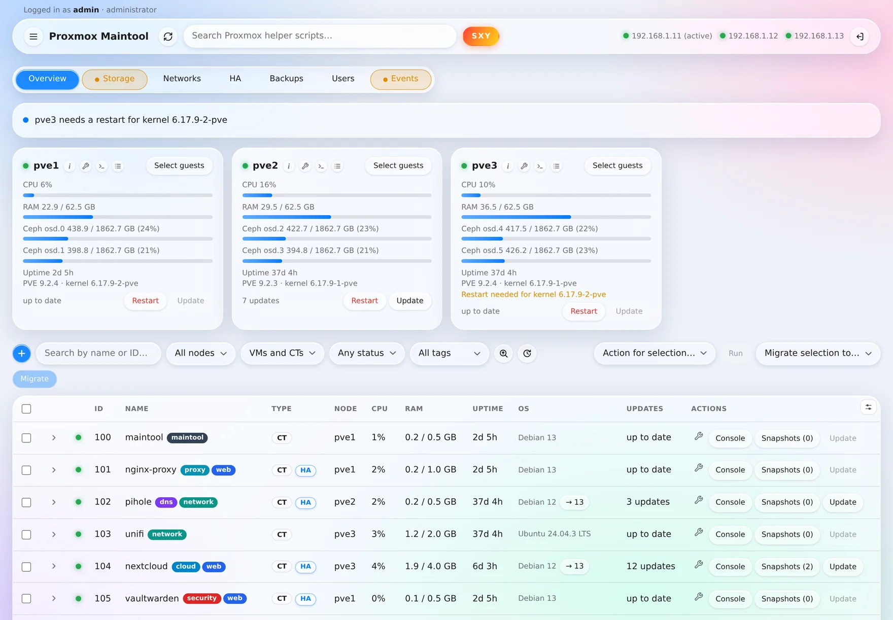
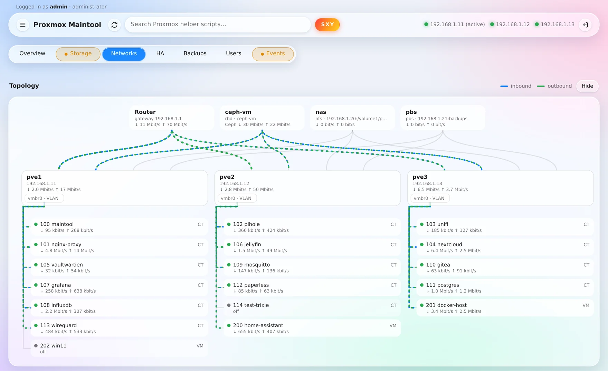
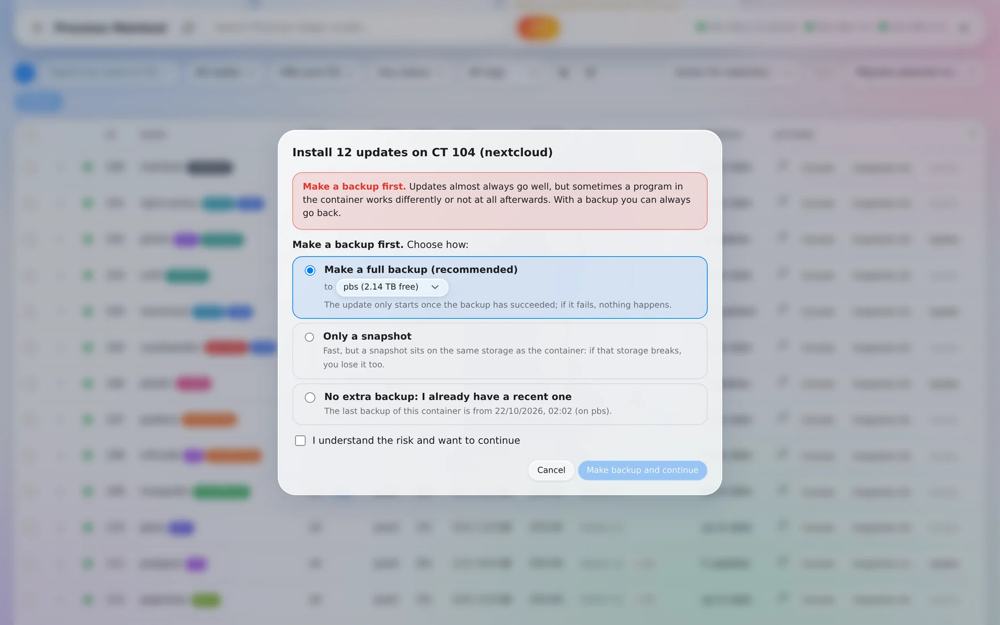
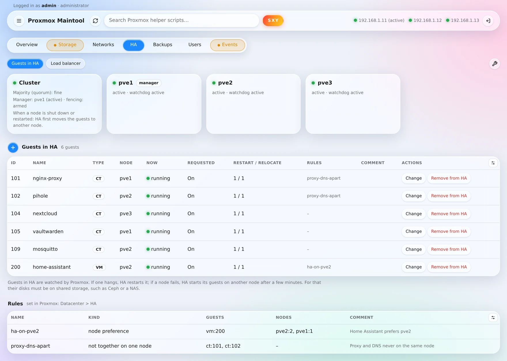
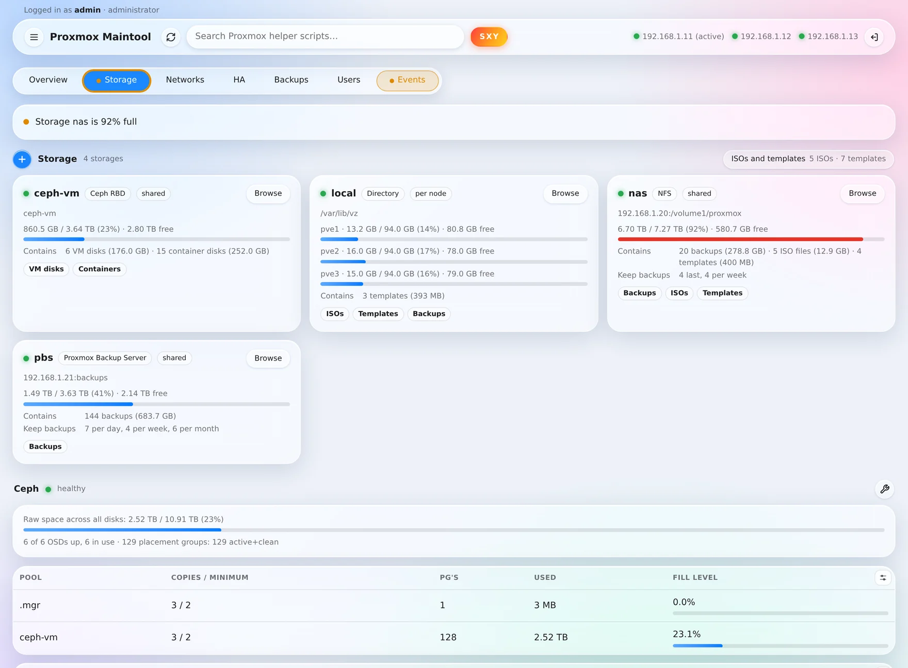
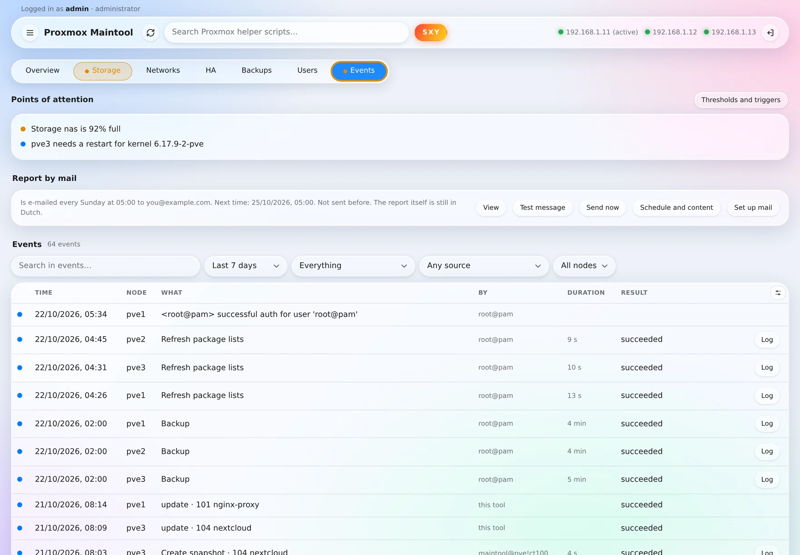
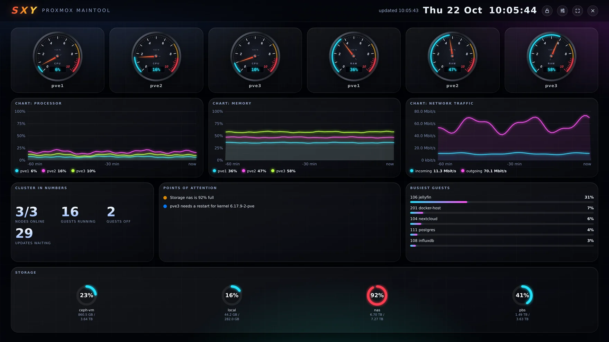

# Proxmox Maintool

A web page for the day-to-day maintenance of a Proxmox VE environment, in Dutch, English or German.
Made by Eduard Wichers.

This explanation is also available in Dutch ([LEESMIJ.md](LEESMIJ.md)) and German ([LIESMICH.md](LIESMICH.md)). All three come with the setup file.

**[Download version 1.4.1 as ZIP](../../archive/refs/tags/v1.4.1.zip)**: the file name contains the version number (the green Code button always gives …-main.zip). You can hand this ZIP to **Update the tool** in one go. Unpacked, the setup file `maintool-setup.sh` is at the top, to install the tool on a node; the rest is the source code. <!-- github -->

 <!-- github -->

## Read this first

- **The tool gets administrator rights on your whole cluster.** It uses an access key (API token) with the
  Administrator role and may start a fixed helper script as root on every node (installing updates, restarting a
  node). Anyone who can log in to the tool as an administrator can therefore stop, migrate and restore containers
  and VMs from a backup, and restart nodes. Someone with the role of one tab can do that for that part. Someone who
  may only read cannot change anything, but does see everything.
- **Only tested on one environment:** Proxmox VE 9, a cluster of three nodes with Ceph and only containers.
  A single node, a cluster without Ceph, VMs and Proxmox VE 8 have not been tested.
- **Use at your own risk.** There is no warranty and the author is not liable for damage, data loss or outages
  (MIT license, see `LICENSE`). Make sure you have good backups.
- **Do not simply expose the tool to the internet.** Use it at home on your own network, or put a VPN or an extra
  access layer in front of it.

## What the tool can do

- An overview of nodes, containers and VMs, with live CPU, memory and disk usage (Ceph or local disks).
- A Storage tab: every storage with how full it is and what it holds (the Browse button shows what is on it), the
  health and pools of Ceph, and the disks in the nodes with their health and wear. With the wrench at Ceph you manage
  monitors, managers, OSDs, pools and flags, and you build Ceph where it is not running yet.
- A library of ISOs and container templates (Storage tab, button ISOs and templates): the tool finds them on every storage by itself and shows
  on which nodes they can be used. You have an ISO downloaded from a web address (Proxmox fetches it itself), you fetch
  a template from the Proxmox list, and you delete what you no longer need (an ISO only if no VM has it in its CD
  drive). When you create a VM or container, you pick from this library.
- Per node a balloon with brief information (the small i next to the name), and a wrench for the settings of that
  node: note, time zone, DNS, Wake-on-LAN, the delay before the guests start, and the package sources (switch them on
  or off, or add a standard Proxmox source).
- Per node a log (the button next to the console): its system log with a filter on period, source, text and problems
  (it can also be saved as a file), its tasks with the log of each task, the state of its services, what the cluster
  reports about it and what the tool did on it.
- A Networks tab: the interfaces of every node, VLANs, the network cards and addresses of all guests (with a warning
  for a duplicate address) and the network of the cluster itself. With the plus button you prepare a VLAN: for
  containers and VMs on all nodes at once, or as an extra connection for one node. For each network card of a guest
  you choose another network or a VLAN you created in the Network and VLAN columns.
- On the Networks tab a topology: the router, the shared storage, the nodes with their bridges and the guests on them, with moving
  flows that show how much traffic goes over each connection right now.
- An Events tab: what needs attention right now (node gone, Ceph, full storage, HA, disks) and what has happened: the
  tasks of every node, messages from the cluster and what was done through the tool, with filters (also for your own
  period from date to date) and the log of each task.
- Points of attention per tab: the button of a tab turns orange for a warning and red for an error in that part;
  without a colour everything is fine. Events counts everything together. With Thresholds and triggers (Events tab)
  you decide yourself what counts as a warning or an error, at which percentage, or whether a message is switched off
  entirely.
- Per guest a wrench to edit it: name, cores, memory, swap, start with the node, protection and the note, the tags,
  the IP addresses and DNS of its network cards, and making its disks larger.
- Tags of containers and VMs, in the colours of Proxmox: next to the name, editable with the wrench, and a click on a
  tag (or the All tags list) shows only the guests with that tag.
- The SXY button: a full-screen dashboard for on the wall, with gauges, graphs of the last hour, points of attention,
  the busiest guests, the storage, a clock and, if you like, VMs and CTs with their own gauges. Every gauge and tile
  is a widget that you can move and make larger or smaller; you choose what is shown and how often it refreshes.
- Starting, shutting down, restarting and force-stopping several guests at once; migrating to another node. With
  Select guests on a node you tick everything that runs there in one go; clicking again (Clear selection) unticks it.
- Per guest an expandable row with more information: IP address, network, disks, memory, HA and the last backup.
- Deleting guests permanently (only when they are off, after typing their IDs).
- With the plus button: create a container or VM (with the next free IDs and an ISO or template from the library),
  attach an NFS or SMB share as storage, or create a backup schedule.
- Creating, restoring and deleting snapshots.
- Finding and installing updates on the nodes and in containers with Debian or Ubuntu, with a clear warning
  beforehand and the choice of a backup (full, only a snapshot, or a recent one you already have); restarting a node
  safely.
- Automatic updates on one or more schedules: per schedule the chosen containers and optionally the nodes, its own
  moment and a snapshot or backup beforehand.
- Bringing a container to the next Debian version, with an optional full backup and always a snapshot beforehand.
- Through Cloudflare Zero Trust, a warning and the choice to only view the tool.
- A Backups tab: manage schedules, make a backup right away and restore. These are ordinary Proxmox backups, which
  you can also restore without this tool. Under Log you see the last run of each schedule and how it went, and every
  backup run with the guests, the storage, the duration, what went wrong and the log.
- An HA tab: how High Availability is doing per node, which guests HA watches, and putting guests in HA, changing
  their HA settings or taking them out again, also for several guests at once. Under Load balancer, Proxmox spreads
  the HA guests across the nodes automatically, if you like with containers only at night. With the wrench you see
  whether the cluster is ready for HA, manage the HA rules, choose what HA does when a node is shut down and disable
  HA temporarily for maintenance.
- A Users tab (administrators only): create, edit and delete the users and groups of Proxmox itself, set passwords
  and grant or revoke rights, and API tokens with their own rights.
- A terminal to a container, and for administrators a console (shell) on a node, inside the page itself.
- Tables the way you want them: columns on and off (for the guests also extra columns, such as disk, cores and tags)
  and a table up or down on its tab.
- Searching the catalogue of Proxmox VE Helper-Scripts (community-scripts.org).
- Optionally a report by mail: every day, every week, every other week or every month, with the parts you choose,
  and if you like only when something is wrong. You set up the mail in the page, for Gmail, Outlook, Microsoft 365,
  iCloud, Yahoo, Ziggo, KPN or your own mail server, and you can send a test mail.
- Your own background colour, and the language of the page (Dutch, English, German) through the menu.
- Updating the tool itself by handing the setup file of a newer version, or straight away the ZIP from GitHub, to the
  page.
- Changing the password of the tool through the menu.
- Logging in with a security key (YubiKey or passkey): without a password, or as an extra step after the password.
- More users, each with their own password: as administrator, read only, or with the role of one or more tabs (menu,
  Users). There the administrator also decides how long a password must be at least.
- Log in with SSO: OpenID Connect (Microsoft Entra ID/Azure, Google, Authentik, Keycloak and the like), Cloudflare
  Access or a Proxmox account. For each user you link their account, and whether they may also still log in with a
  password.

## What you need

- Proxmox VE 9 (version 8 may work, but has not been tested), on ordinary PC hardware (amd64).
- Root access to the shell of one node.
- A free, fixed IP address in your network for the container.
- Internet for the container during the installation (Debian and Python packages).
- About 5 GB of free storage and 512 MB of memory.

## Installing

1. Put `maintool-setup.sh` on a node, for example from your own computer:

       scp maintool-setup.sh root@ADDRESS-OF-YOUR-NODE:/root/

   If you downloaded the ZIP from GitHub, unpack it: the setup file is `maintool-setup.sh`, at the top next to this
   explanation. The other files are the source code; if you like, `bash build.sh` makes a setup file from it yourself
   (`dist/maintool-setup.sh`). ZIPs up to and including version 1.4 do not contain the ready-made setup file yet.

2. Open the shell of that node (in the Proxmox web interface: node > Shell) and start:

       bash /root/maintool-setup.sh

3. Choose the language (English, Nederlands or Deutsch; Enter takes the suggestion), read the warning, answer the
   questions and confirm the summary. Nothing changes until you confirm.

Before the questions, the setup file checks that every node can be reached at the address under which the cluster
knows it. If not, usually because of an old address in `/etc/hosts` on that node after its address was changed, it
says what to do about it and asks whether you want to continue anyway. It works with any language setting of the
node (also `en_US.UTF-8`).

In order, the setup file asks for: the language; `agree` after the warning; the ID and the name of the new
container; the storage for its disk and for the Debian template; the network (bridge); a fixed IP address with
network size, for example 192.168.1.50/24; the router (gateway); a VLAN number (empty if you do not use VLANs); and
the user name and password for the tool (at least 8 characters; what you type stays invisible). After the summary,
type `yes` to carry it out; anything else stops.

A value in square brackets is the default: Enter accepts it. For a choice from a list, type the number in front of
the option, or its name. To skip the language question, put the language first: `bash maintool-setup.sh --lang en`
(or `nl`, `de`). `bash maintool-setup.sh --readme` shows this explanation (`--leesmij` in Dutch, `--liesmich` in
German).

After a few minutes the tool is ready at `https://THE-CHOSEN-ADDRESS:8443`. The first time, your browser warns about
the certificate, because the tool makes its own certificate. That is normal.

At the end a self-test runs that reports what works and what does not.

## What the setup file creates

- A container (Debian, 1 core, 512 MB, 4 GB) with the tag `maintool`, in which the tool runs.
- In Proxmox, the user `maintool@pve` with the Administrator role, and an access key `ct<ID>` that is only known
  inside the container. Every installation gets its own key.
- On every node, the helper script `/usr/local/sbin/maintool-agent`.
- One line in `/etc/pve/priv/authorized_keys`: the SSH key of the container may only start that helper script, and
  only from the address of the container. A copy of the file is made in `/root` first.
- A log of the installation in `/var/log/maintool-setup.log` (without passwords or keys).

## Updating and removing

The easiest way: open the menu in the tool, choose **Update the tool** and hand over the setup file of the newer
version there, or straight away the ZIP of that version from GitHub: the tool then takes the setup file out of it
itself. The latter works from version 1.4.1 on (both the running tool and the ZIP); if an older version is running,
unpack the ZIP first and choose `maintool-setup.sh`. The tool checks the file, asks for your password, keeps a copy of the old version and puts it back by
itself if the new one does not start properly. This only replaces the tool itself. If a new version changes more
(the helper script on the nodes, the service, Python packages), the page says so and you use the setup file on the
node:

    bash maintool-setup.sh --update ID

It asks for the language, and then for `yes` to continue.

Removing everything again (the container, the access key, the line in `authorized_keys` and, if no other Maintool
uses them, the user and the helper script):

    bash maintool-setup.sh --uninstall ID

To confirm, it asks you to type the ID of the container.

Both must run on the node where the container is at that moment.

## Forgotten password

A password you changed in the tool is stored only as a hash in the container. If you have lost it, delete that file
on the node; after that, the password you chose during the installation applies again:

    pct exec ID -- rm /var/lib/maintool/auth.json

That first password is stored as `APP_PASSWORD` in `/etc/maintool/maintool.env`, and you can also change it there
(then run `systemctl restart maintool` in the container).

This is about the main account, which you chose during the installation. An administrator sets a new password for
another user in the tool, through the menu under Users. Removing all extra users at once is also possible:

    pct exec ID -- rm /var/lib/maintool/users.json

## Users and roles

In the menu under Users, an administrator creates extra users. Everyone who can log in may view everything. What
someone may change depends on their roles; the names match the tabs:

- **Overview**: start, stop, migrate, edit (including their IP address and disks), create and delete guests,
  snapshots, updates (including automatic updates), the console and restarting nodes, HA (including the rules and maintenance) and the load balancer.
- **Storage**: attach an NFS or SMB share as storage, manage the library of ISOs and templates, and set up Ceph.
- **Networks**: prepare, apply and delete VLANs, and change the network of a guest.
- **Backups**: schedules, making a backup right away, restoring and deleting backups.
- **Events**: the mail, the schedule and content of the report by mail, and the thresholds and triggers.

You can combine roles. Without a role someone may only read. Only an administrator may manage users, update the
tool and set the minimum length of passwords (8 to 128 characters, 12 by default). That length applies to every
password chosen after that; existing passwords keep working.

At the top of the page you see who you are logged in as and what you may do. You log out with the button at the top
right.

## Staying logged in and logging out

- The login page has the checkbox **Stay logged in**: the session then also stays after closing the browser, 30 days
  by default. Without the checkbox the session disappears when you close the browser, and it expires after 12 hours
  at the latest. The checkbox also applies to logging in with SSO.
- In the menu under Users, under Sessions, an administrator sets after how long without activity the page logs out
  (never, or from 15 minutes to 8 hours), how long a normal session lasts at most (1 to 24 hours), and whether and how
  long Stay logged in is allowed (7, 14, 30 or 90 days).
- A minute before logging out, the page asks whether you are still working. Activity is the mouse, the keyboard,
  touching or scrolling in a tab of the tool; refreshing in the background does not count. The wall dashboard (SXY)
  and whoever stays logged in are not logged out. The page logs out by itself; a session that is not open anywhere
  expires at its own time.

## Security keys (YubiKey, passkey)

In the menu under **Security keys** you add a key: a YubiKey or another FIDO2 key, or a passkey on your phone or
computer. After that you can:

- **log in with only the key**, with the button Log in with security key on the login page. The key then asks for its
  PIN or your fingerprint. If you fill in your user name first, the browser only offers your keys.
- **have the key asked after your password**, with the tick box under After the password. Logging in with only a
  password is then no longer possible, not with a Proxmox account either. With OpenID Connect and Cloudflare Access,
  that service handles an extra step itself.

Good to know:

- A key works on the address where you added it, for example your Cloudflare address. Browsers do not allow security
  keys on an IP address or with a certificate error, so through the IP address in your own network it does not work.
  If the key is required for you, you can no longer log in with only your password through that IP address either.
- You confirm a change to your keys with your password. The tool only stores the public key, nothing with which
  someone else could log in.
- Lost your key? An administrator removes all your keys in the menu under Users, with **Remove keys**. If you are the
  only administrator yourself, remove everyone's keys on the node:

      pct exec ID -- rm /var/lib/maintool/webauthn.json

## Console of a node

Administrators have a **>_** button on every node card for a console (shell) on that node, in a window in the page.
Proxmox only gives such a console to an account of the node itself (realm pam), such as root, and not to the access
key of the tool. The first time you therefore log in with such an account, with the code from your authenticator app
if the account has two-factor authentication. The tool does not store the password and only remembers the login for
this browser session, at most one hour; logging out of the tool forgets it too. Events shows who logged in and who
opened a console.

If root@pam is switched off in Proxmox (a common extra protection), the window says so. Then use another pam account
that may open a console: a Linux account on the nodes that exists in Proxmox (Users tab) and has the right Sys.Console
on the nodes, for example with the role PVEAdmin. Because Proxmox only lets root in directly, the console then asks
you to log in once more itself.

## Adjusting tables

At the top right of every table on a tab there is a small button. With it:

- you switch columns on or off. For the guests on the Overview you can also add extra columns: disk, cores, tags, pool
  and HA state;
- you move the table one place up or down on its tab (on the Overview also above or below the node cards);
- **Default** puts everything on that tab back.

Your choices belong to your user and apply on every device you log in on.

## Log of a node

The button with the lines on the card of a node (next to the console) opens its log. Everything is about exactly that
one node, and the tool only reads:

- **System log**: the log of the node (journal) over the last quarter of an hour, hour, 6 or 24 hours, or the last
  5000 lines. Choose a source (a program or service, such as corosync or pveproxy), search for text or show problems
  only: errors in red, warnings in orange. Save as file gives you what you see as a text file.
- **Tasks**: the latest tasks of the node, including older ones that failed, with the log of each task.
- **Services**: which services are running and which are not; a service that should start along but is not running
  is red.
- **Cluster log**: what the cluster reports about this node, such as failed logins.
- **By the tool**: what the tool did on this node in the last 30 days (updates, restarts).

## Topology

At the top of the Networks tab, the topology draws how the cluster is put together: on top the router and the shared
storage (Ceph, NFS, SMB, PBS), below that the nodes with their bridges, and under each node its containers and VMs,
each on its bridge. A flow runs over every connection: blue inbound (towards the node or guest), green outbound. The
thicker and faster, the more traffic; the boxes show the figures. The traffic of a node is the average of the last
minute (from Proxmox), that of a guest is updated every 2 seconds. The traffic to a storage is an estimate from the
disks of the guests; for Ceph the box shows the traffic of the whole cluster. Click a guest to show it in the
overview. Hide folds the topology away; this browser remembers that.

 <!-- github -->

## Tags

The tags of containers and VMs appear next to their name, in the same colours as in Proxmox (you set your own colours
in Proxmox: Datacenter, Options, Tag Style). You change them with the wrench of a guest: separated by spaces or
commas, and tags that are already used elsewhere can be added with one click. A click on a tag in the table (or the
All tags list) shows only the guests with that tag; another click shows everything again. The container of the tool
itself keeps its tag `maintool`: that is how the setup file recognises it.

## Updates and automatic updates

If you click Update on a container, or the button for a new Debian version (for example → 13), a window first
appears with a warning and the choice of how to protect yourself:

- **Make a full backup (recommended)**, to a backup storage you choose. The tool makes the backup itself and only
  starts the update once it has succeeded; if the backup fails, nothing happens. This carries on, even if you close
  the page.
- **Only a snapshot**: fast, but a snapshot is on the same storage as the container. For a new Debian version the
  tool always makes that snapshot anyway.
- **No extra backup: I already have a recent one**; the window shows when the last backup was made.

You must tick that you understand the risk. For a node, Proxmox itself cannot make a backup; there it stays at the
warning.

 <!-- github -->

With the clock button next to Check for updates (Overview tab) you set up **automatic updates**, with one or more
schedules. Each schedule has its own name, how often (every day, every week, every other week or every month), on
which day and at what time, which containers (all, including new ones, or a selection) and whether the nodes should
be included, and what happens beforehand (a snapshot, a full backup or nothing). That way you can, for example, update
the websites every night and the rest once a week. If a container is in more than one schedule, the choice shows an
asterisk, and hovering over it tells you which. One run takes place at a time; if two schedules coincide, they run
one after the other. A schedule from before version 1.4 automatically becomes the first schedule. At the moment
itself:

- all package lists are refreshed first;
- the containers are updated one by one, only if they are running, have Debian or Ubuntu, have updates and are not
  locked (for example by a backup). A failed backup beforehand means: do not update that container;
- with a snapshot beforehand, the tool then removes the previous automatic snapshot (`auto_update_...`) of that
  container; other snapshots always stay;
- then the nodes, one at a time, only if all nodes are online, the cluster has a majority and Ceph has finished
  recovering. After each node the tool waits until everything is fine again. Nodes are never restarted
  automatically; a node that needs a restart appears in the points of attention.

If the tool was off at the planned moment, it still happens up to three hours later. The list shows per schedule when
it runs next and how the last run went (Edit shows every outcome); every outcome also appears under Events and in the
report by mail, and a failed run becomes a point of attention. With Now you start a run of that schedule right away.

## Through Cloudflare Zero Trust

Through Cloudflare Zero Trust the tool is slower, and a connection can drop halfway, for example during an update, a
backup or in the console. That is why someone who opens the tool through Cloudflare first gets a window with a
warning and the choice **View only (recommended)** or **Use fully anyway**. Someone who only views sees everything,
but cannot change anything; the tool also refuses it itself. You can switch at the top of the page. The choice applies
until you close the browser. In the window you also choose the language. If no answer comes through Cloudflare, the
window says so after 20 seconds and you can try again.

If your Cloudflare Access login expires while the page is open, the tool says so at the top, with the button Log in
again. How long that login lasts, you set in Cloudflare Zero Trust: Access, Applications, the application of the
tool, Session Duration (for example 24 hours).

In the Users window, under Access through Cloudflare, an administrator can also choose **always view only** (then
nobody can change anything through Cloudflare) or **ask nothing**. On your own network, without Cloudflare, this does
not apply.

## HA (High Availability)

A guest in HA is watched by Proxmox: if it hangs, HA restarts it, and if its node fails, HA starts it on another node
after a few minutes. The HA tab shows whether the cluster has a majority, which node controls HA, how HA is doing per
node (for example active or in maintenance mode) and which guests are in it, with their state, what HA should do
with them and how often HA may try again.

 <!-- github -->

- **Add** with the plus button on the tab, or in the overview through Action for selection, Add to HA. You choose one
  or more guests and what HA does with them. By default everything stays as it is: a guest that is running gets On, a
  guest that is off gets Off. If you choose something else, the window tells you beforehand which guests HA will start
  or stop right away.
- If a disk (or a CD-ROM with an ISO) of a guest is not on shared storage such as Ceph or a NAS, the tool says so: HA
  cannot start such a guest on another node when its node fails.
- **Change**: On (HA keeps it running), Off (HA keeps it off, but does move it when the node fails), Disabled (off and
  not moved; this is also how you clear an error: first Disabled, then On again) or Ignored (HA leaves it alone, for
  example during maintenance). Also how often HA retries a guest that will not start on the same node and then on
  another node, and a comment.
- **Remove from HA**: the guest stays as it is (running stays running, off stays off), but is no longer watched.

Who may do this: administrators and everyone with the Overview role. Every change appears under Events, with who did
it. The tool does not stop its own container through HA. An HA guest in the overview has a small HA button; it takes
you to the tab.

## Load balancer (HA tab)

Proxmox VE 9.2 can spread the guests in HA across the nodes by itself (Cluster Resource Scheduling). On the HA tab,
under Load balancer, you see how that is doing and you set it up; the tool itself moves nothing.

- **Set up**: whether Proxmox balances automatically, what it looks at (Dynamic: the actual use of processor and
  memory, recommended; Static: the configured cores and memory; Basic: only the number of guests, and then automatic
  balancing is not possible) and whether an HA guest that starts goes to the quietest node. Under Fine-tuning: from
  which imbalance Proxmox balances (30% by default), how much better it must get at least (10%), for how many rounds of
  about 10 seconds the imbalance must last (3) and the scoring method.
- **Per guest** you switch on or off whether it takes part. Only guests in HA take part; the guests that are not in
  HA are listed below, with a button to add them to HA. A guest with a disk on local storage cannot move; the tool
  says so.
- **Containers only at night**: a VM moves while it keeps running, a container goes off for about 10 to 20 seconds.
  With the time window (for example from 02:00 to 05:00) containers only take part within those hours: outside them
  the tool switches their participation off in Proxmox, inside the window on again. If that fails, the HA tab turns
  orange.
- You see the load per node, the imbalance according to Proxmox, and the moves of the past week: from which node to
  which, who started them (the HA manager, the tool or a user) and how they went.

Who may do this: administrators and everyone with the Overview role. Every change appears under Events. The setting is
stored in Proxmox itself (Datacenter > Options > Cluster Resource Scheduling), so it also works when the tool is off;
only the time window needs the tool.

## Set up HA (wrench on the HA tab)

- **Readiness**: whether the cluster is ready for HA: at least three nodes, a majority, shared storage for guests, the
  HA manager and the monitoring on every node, and which guests in HA have a disk on local storage.
- **Rules** (Proxmox VE 9): prefer nodes (with priority, and strict: only there), not on certain nodes, together on one
  node, or not together on one node. Proxmox places the guests according to a new rule right away; a container that
  has to move for that goes off briefly. On Proxmox VE 8 you set up the HA groups in Proxmox itself.
- **Settings**: what HA does when a node is shut down or restarted.
- **Maintenance**: temporarily disable HA (Proxmox VE 9.2), for example for work on the network or on the cluster
  itself, so that a node that is briefly unreachable is not fenced. You choose whether the guests stay as they are or
  whether you can start, stop and move them yourself. As long as HA is off, the HA tab is orange; enable HA again
  right after the maintenance.

## Set up Ceph (wrench on the Storage tab)

 <!-- github -->

- **Overview**: the health, the network, the version per node, and per node the monitor, the manager, the OSDs and the
  free disks. If Ceph is not running yet, this shows the steps to build it. You install the packages per node in the
  shell (`pveceph install --repository no-subscription`); then the tool sets up Ceph with the network you give, and you
  add monitors, managers, OSDs and a pool.
- **Monitors and managers**: add and delete them. The tool does not remove the last monitor or manager, and a monitor
  only if Ceph says the majority remains.
- **OSDs**: take them in or out, stop and start them, make an OSD of a free disk and delete an OSD. Before stopping and
  deleting, the tool first asks Ceph whether it is safe; taking an OSD out is refused if too few nodes would remain for
  the pools. Creating or deleting an OSD wipes the disk; to confirm, you type the name of the disk or the OSD.
- **Pools**: create them (added to Proxmox as storage right away), change them (copies, minimum, automatic scaling)
  and delete them. The tool does not delete a pool that still holds disks, or a pool of Ceph itself.
- **Flags** for maintenance, such as noout. The tool does not set flags that stop everything (pause, noup, nodown).

Who may do this: setting up HA, administrators and the Overview role; setting up Ceph, administrators and the Storage
role. Every change appears under Events.

## Proxmox users and groups (Users tab)

The Users tab is about the users of Proxmox itself, with which you log in to Proxmox (in Proxmox: Datacenter,
Permissions). The users of this tool itself are managed through the menu (the three lines at the top left), under
Users. The tab is only there for administrators of the tool.

- **Users**: create them in a realm (for **pve** you choose a password; for **pam** the Linux account must already
  exist on every node; for another realm, that realm handles the login), with name, e-mail, comment, a date on which
  the account expires, on or off, and the groups. Edit, set a new password (realm pve) and delete.
- **Groups**: create them with a comment and members, edit and delete. The users themselves keep existing.
- **Rights**: per user or group, a role on a place: everything, all guests or one guest, storage, a node or a pool.
  Next to a role it says what that role may do. A user also gets the rights of their groups; that is shown too.
- **API tokens**: for scripts and other programs. You make a token for a user, with a comment and a date on which it
  expires. With **own permissions** (recommended) the token may only do what you give it with the Permissions button,
  and never more than its user; without them it may do exactly what the user may do. You see the secret of a new token
  once, with the line to use in a script; the tool does not store it. The tool does not change tokens of root@pam or
  of the user of the tool.

The tool protects you from locking yourself out. It does not change root@pam or the user the tool itself works with,
and it refuses a change after which nobody may do everything in Proxmox any more (Administrator on /), apart from the
tool itself: switching off the last administrator, letting it expire, deleting it, taking away its right or giving it
NoAccess. For far-reaching rights on everything, the page asks for confirmation first. Passwords are only passed on to
Proxmox; the tool does not store or log them. Every change appears under Events, with who did it.

## Log in with SSO

Besides its own password, an administrator can switch on three methods in the Users window with the Set up SSO
button. After that you link, per user (the Edit button; for the main account and for yourself, the SSO button), which
account belongs to them. Only someone who is linked gets in, with the rights they have in the tool; users are never
created automatically. An account belongs to one user. For a user you can switch off logging in with a password;
they then only get in through SSO. The main account always keeps its password, so you can never lock yourself out.

- **OpenID Connect** (Microsoft Entra ID/Azure, Google, Authentik, Keycloak or another OpenID service). Create an app
  at that service with the address the tool shows as redirect URI (`https://ADDRESS/api/sso/oidc/callback`), and fill
  in the issuer, the client ID and the client secret in the tool, plus the address at which you open the tool. For
  Microsoft the issuer is `https://login.microsoftonline.com/<tenant-ID>/v2.0`, with your own tenant ID. Google and
  Microsoft require a real web address, such as your Cloudflare address; an IP address does not work there. Per user
  you link the mail address with which they log in at the service. At the first login the tool records which account
  at the service that was; after that only that account gets in, even if another account later shows the same mail
  address. The client secret is stored readably in `/var/lib/maintool/sso.json` (the tool has to send it along); that
  file is only readable for the tool and the secret is never shown in the page.
- **Cloudflare Access**. If the tool is behind Cloudflare Access, you have already logged in there. Fill in the team
  name (the first part of `yourteam.cloudflareaccess.com`) and the Application Audience (AUD) Tag of the application;
  you find them in Cloudflare Zero Trust under Access, Applications. Someone who opens the tool through the Cloudflare
  address and is logged in at Cloudflare with a linked mail address gets in right away. The tool checks the
  Cloudflare token with the public keys of your team. After Log out this no longer happens automatically; there is
  then a button on the login page. Through the address on your own network, the ordinary password is needed.
- **Proxmox account**. On the login page you then choose Proxmox account and the realm (for example pam), and log in
  with the user name and password of Proxmox itself. Proxmox checks the password; the tool only asks for it for
  accounts that are linked to a user (for example `jan@pam`). Accounts with two-factor authentication cannot be used
  (yet).

## Thresholds and triggers

On the Events tab, the Thresholds and triggers button opens the list of everything the tool watches, per tab. For
each line you choose whether it is an error, a warning or only a notice, or whether it is off. For percentages
(memory of a node, a full disk or storage, wear of a disk) you fill in from which percentage it is a warning and from
which percentage it is an error. The message about old backups is off by default; you switch it on by filling in a
number of days. With Default everything goes back to how it was.

The colour of the tabs, the list of points of attention and the dashboard follow these settings. The tool works out
the points of attention again about once a minute.

 <!-- github -->

## Dashboard for on the wall (SXY)

The SXY button in the header opens a dark, full-screen dashboard. Everything on it is a widget: per node a gauge for
processor and memory, graphs of the last hour (processor, memory, network traffic), the cluster in figures, the points
of attention, the busiest guests, the storage and a clock. Under VMs and CTs you can also choose guests that get a
widget of their own: with gauges for processor and memory, whether it is running, on which node, for how long, and
for a container how full its disk is.

 <!-- github -->

- **Changing the layout**: open the lock at the top right. Drag a widget to another place; the others move along, like
  widgets on a phone. With the corner at the bottom right you make a widget larger or smaller, with the cross you
  remove it. It also works with the keyboard: arrows move, Shift with arrows changes the size. Close the lock again
  when you are done (or press Esc).
- **What is shown and how often it refreshes**: the button with the sliders. There you switch widgets on or off,
  choose how often gauges and figures refresh (every 2 seconds to every minute) and the graphs (every 30 seconds to
  every 10 minutes), and whether everything must fit on one screen. Default layout puts all widgets back in their own
  place and size.
- The layout and the refresh rates are stored with your user, so they apply on every screen where you log in with
  that user. On a phone the widgets are below each other and there is no lock.

You close it with the cross or Esc.

If you put `#sxy` after the address of the tool (for example `https://ADDRESS:8443/#sxy`), the dashboard opens
right after logging in. As long as the dashboard is open, that browser stays logged in and tries to keep the screen
on. For a screen on the wall, therefore use a user without roles (read only), and tick Stay logged in when logging
in; then the screen also stays logged in after a restart of the browser.

## Report by mail (optional)

On the Events tab there is the Report by mail block. There you see whether it has been set up, you can view what the
report looks like, send it right away or send a short test mail.

With Schedule and content you choose how often it comes (every day, every week, every other week, every month or not
automatically), on which day and at what time, which parts are in it (points of attention, nodes, VMs and CTs,
backups, updates, storage and Ceph, failed tasks) and whether it is only sent when there are points of attention. The
report always covers the past period; points of attention of a part that is switched off do not count. Without a
schedule of your own it comes every week on the day and time from `maintool.env` (Sunday 05:00 by default). If the
tool was off at the planned moment, it still comes, up to a day later (for every day: half a day).

With Set up mail you first choose the kind of mail server: Gmail, Outlook.com, Microsoft 365, iCloud, Yahoo, Ziggo,
KPN or another or your own server. For a known kind the tool fills in the server, the port and the encryption itself.
For your own server you choose them yourself: STARTTLS, SSL/TLS or no encryption, with or without logging in, and if
needed a separate login name or a server with its own certificate. You can also give a sender name. When you save,
the tool connects to the mail server once to check that it is right; if that fails, nothing is saved.

For Gmail you need an app password, not your ordinary password: create it in your Google account under Security,
2-Step Verification, App passwords. iCloud and Yahoo also work with an app password. If you only want another
recipient address, leave the password empty. If you change the server or the login name, you have to fill in the
password again: the tool never sends a stored password to another server. No password is sent over a connection
without encryption.

The password is stored readably in `/var/lib/maintool/mail.json` in the container (the tool has to log in with it);
that file is only readable for the tool and the password is never shown in the page. You can also still set up the
mail with the `MAIL_` lines in `/etc/maintool/maintool.env`; what is set in the page takes precedence.

## Known limitations

- The page, the setup file and this explanation are available in Dutch, English and German. The report by mail is
  only in Dutch, and so are the log of an update in a container and the comments in the settings file
  `maintool.env`.
- Deleting is only possible for guests that are off and not protected in Proxmox; the container of the tool itself
  cannot delete itself. Backups on the backup storage stay.
- Updates and the console work for containers; VMs you can start, stop, migrate and back up.
- Updates work in containers with Debian or Ubuntu (apt). Other systems are shown without an update button.
- In a cluster the tool only uses shared storage (NFS, CIFS, PBS) for backups. With one node, every backup storage
  counts.
- Nodes with their own certificate on the web interface (for example Let's Encrypt) can probably not be reached by
  the tool: it checks nodes with the certificate of the cluster.
- You create a VM here, but you install it afterwards in Proxmox itself through the console of the VM. You have an
  ISO downloaded through the library; uploading from your own computer you do in Proxmox itself (storage > ISO
  Images). Attaching storage works for NFS and SMB; other kinds you do in Proxmox. Browsing a storage is view only.
- Automatic updates work for containers with Debian or Ubuntu and for the nodes; the tool does not update VMs, and
  nodes are never restarted automatically. Whether someone comes through Cloudflare, the tool sees from what
  Cloudflare itself adds to every request.
- If a node joins the cluster, the tool shows it by itself and also uses it as a fallback for the connection; a node
  that was removed from the cluster disappears by itself. For updates and restarts, the helper script still has to be
  put on a new node: run `bash maintool-setup.sh --update` on a node. The tool says so on the card of that node.
- A VLAN is prepared first and only becomes active after Apply. When applying, Proxmox reloads the network settings:
  of one node, or for a VLAN for containers and VMs of all nodes. The tool first shows what changes. Do not do this
  during a backup, migration or update, and make sure you can get to a node if the connection drops. A VLAN for
  containers and VMs uses SDN (Proxmox VE 8.1 or newer). Bridges, bonds, and changing or deleting interfaces of a
  node you do in Proxmox itself.
- Changing the network or VLAN of a guest takes effect immediately for a running guest; it can become unreachable
  briefly or permanently if the new network is not right. The tool asks for confirmation first, leaves the rest of
  the network card (MAC address, IP address, firewall) alone and does not change the network of its own container.
- When editing a guest you cannot add disks or network cards; you do that in Proxmox itself. For a running VM, cores
  and memory usually only take effect after a restart; the tool says so. A locked guest and a template are not
  changed, and the tool does not rename its own container.
- You change the IP address of a guest in the wrench window, per network card: a fixed address with gateway (for
  example `192.168.1.50/24` and `192.168.1.1`), DHCP or none, and for IPv6 also automatic, plus the DNS servers and
  the search domain (empty: like the node). For a running container it takes effect immediately and connections to
  the old address drop; the tool asks for confirmation first. For a VM it is only possible if it has a cloud-init disk
  (and it applies after a restart); otherwise you set it in the VM itself. The tool refuses an address that already
  belongs to another guest or a node, leaves the rest of the network card alone and does not change the address of
  its own container.
- A disk can only grow, never shrink (Proxmox cannot do that), and at most by what is free on the storage. In a
  container the file system grows along by itself; in a VM you then have to enlarge the partition and the file system
  in the VM itself. The tool does not enlarge EFI, TPM and cloud-init disks, CD-ROMs, or folders or devices of the node.
- SSO with Google or Microsoft only works through a real web address (for example your Cloudflare address). A
  Proxmox account with two-factor authentication cannot log in. If an SSO link is removed or changed, that user has to
  log in again; for the main account, existing sessions simply run out (after 12 hours).
- HA groups (Proxmox 8) and the maintenance mode of a single node you set up in Proxmox itself (Datacenter, HA). HA
  rules (Proxmox 9), what HA does when a node is shut down and disabling HA temporarily are possible in the tool.
- Installing the Ceph packages, CephFS and metadata servers, and OSDs with a separate disk for DB or WAL you do in
  Proxmox itself.
- The load balancer is the one of Proxmox itself (from Proxmox VE 9.2 on): it only balances guests in HA, one at a
  time. The time window for containers is handled by the tool; if the tool is off when the window opens or closes,
  that happens as soon as it runs again.
- On the Users tab you do not manage two-factor authentication, realms or custom roles; you do that in
  Proxmox itself. If Proxmox asks for the password of the person changing it when setting a new password, the tool
  cannot do that (it works with an access key) and tells you to do it in Proxmox itself.
- In the settings of a node, the tool does not change the name and the network of the node (the network is on the
  Networks tab). A wrong DNS server or switching off all Proxmox sources can block the updates of that node; the
  window warns about that. You set up each node separately.
- The Events tab goes back at most 30 days and shows what Proxmox itself keeps track of; console sessions are not in
  it.
- Someone who may only read sees everything the tool shows, including names, IP addresses, backups and the report.
- The console ends up at the login prompt of the container; you need the root password of that container there.
- The container of the tool itself has no root password. You get in with `pct enter ID` on the node.

## If something does not work

    pct exec ID -- runuser -u maintool -- /opt/maintool/venv/bin/python /opt/maintool/selftest.py
    pct exec ID -- journalctl -u maintool -n 50 --no-pager
    less /var/log/maintool-setup.log

If the page loads slowly, shows errors, or the tool reports that a node does not answer through the API, check
whether the cluster knows that node under the right address. Proxmox takes that address from `/etc/hosts` on that
node; after the address of a node has been changed, the old one is often still there. Put the right address after the
name there and restart that node (or just the service: `systemctl restart pve-cluster`). Meanwhile the tool skips
such a node, so the rest of the page keeps working, and the setup file checks this before installing.

## License and credits

Proxmox Maintool is made by Eduard Wichers and is licensed under the MIT license (see `LICENSE`).
Software by others is listed in `THIRD-PARTY.md`. Proxmox is a trademark of Proxmox Server Solutions GmbH;
this tool is not affiliated with it.
